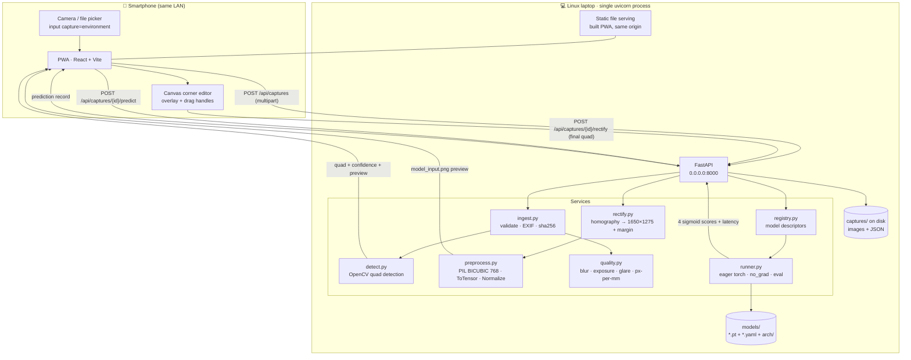
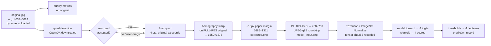
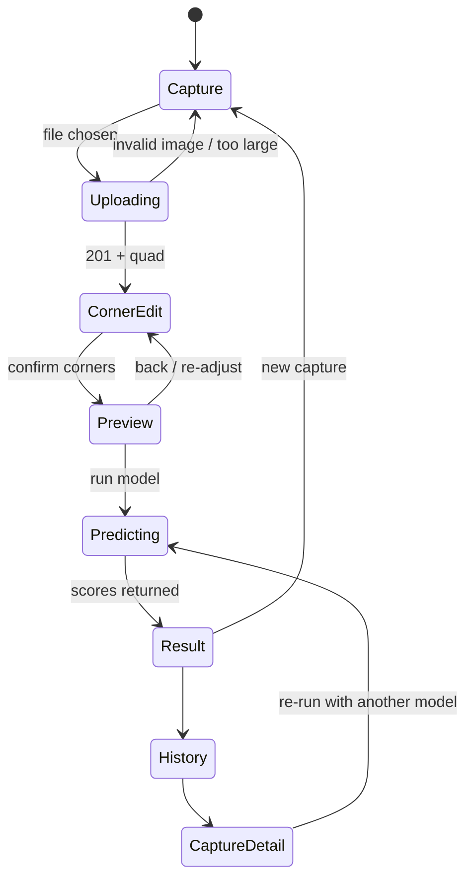

# CardioSentry Web Application — Technical Plan

**Document status:** planning only — no implementation.
**Author role:** lead software architect
**Date:** 2026-08-23

---

## 1. Project Overview

CardioSentry is an image-space multi-label classifier for printed 12-lead ECG sheets. It does **not** digitize waveforms; it consumes the sheet image directly and emits four independent sigmoid logits.

This application exists for one purpose: **to find out what the model does when the input is a real smartphone photograph of a real printed ECG, rather than a synthetic render from the training pipeline.**

That framing drives every decision below. The app is an instrument, not a product. Its job is to (a) get a real photograph into the model in a way that is as close to the training input chain as physically possible, (b) record *everything* about how that happened, and (c) make it possible, months later, to answer "what exactly did the model see, and what exactly did it say?"

### 1.1 Findings from the existing repository that constrain this plan

I inspected the training and evaluation code before writing this. Six facts materially change the design and are referenced throughout:

| # | Finding | Source | Consequence |
|---|---|---|---|
| F1 | Label order is `["STEMI", "AF", "LVH", "NORMAL"]` — the first head is **STEMI**, not general MI | `prototype-code/cardiosentry_hybrids_v1/config.py` | Class names must come from model config and the UI must say STEMI, not "Myocardial Infarction" (see §17.1) |
| F2 | `.pt` files are **not** self-contained. They are `{"model": state_dict, "thresholds": [...], "epoch", "val", "views", "protocol_fingerprint"}` blobs that require the architecture code (`hybrids.py` / `models.py`) to rebuild | `train.py:184`, `external-validation/eval/evaluate.py:184` | The backend needs a vendored architecture registry + a model descriptor file. A naive `torch.load(...)` will fail. This is the single biggest integration risk |
| F3 | Model forward signature differs between checkpoint generations: round-2 hybrids take a **dict** `{768: tensor}`; round-1 models take a plain tensor | `hybrids.py` `GroupedModel.forward`, `cardiosentry_runs_v1/models.py` | The model loader needs a thin adapter, not a single hard-coded call |
| F4 | Frozen per-class thresholds live **inside** the checkpoint and were tuned on the synthetic validation split (e.g. `resnet50_hires`: `[0.44, 0.81, 0.47, 0.39]`) | `prototype-results/hybrid_v1/resnet50_hires/result.json` | Thresholds are per-class, not a single global 0.5. Defaults must be read from the checkpoint; overrides must be recorded |
| F5 | The exact training input chain is known and reproducible: sheet rendered at 150 DPI, **1650×1275 px (US Letter landscape, 11″×8.5″)**, + 18 px paper-coloured margin → **1686×1311**, JPEG q85, then `PIL.Image.resize((768,768), BICUBIC)` → JPEG q95 → `ToTensor()` → `Normalize(ImageNet)` | `image_pipeline/config.py`, `stage4_augment.py`, `prepare_dataset.py:49`, `data.py:build_view_transform` | The app can and should reproduce this chain byte-for-byte in geometry and resampling. See §9 |
| F6 | Training images already contain simulated photographic effects — ±3° rotation, keystone perspective (0.4–1.8%), paper texture, creases, illumination gradient, colour cast, sensor noise, mild defocus | `stage4_augment.py:augment()` | The model is *not* naive about photo-like degradation. Real-world failure, if it happens, is more likely from **layout/paper/source mismatch** than from lighting. Section 17 expands |

Also relevant: the laptop is **CPU-only** (`torchvision 0.28.0+cpu`, no `nvidia-smi`), Python 3.12, torch 2.13. OpenCV and FastAPI are not yet installed. A ResNet-50 forward pass at 768×768 on CPU is roughly 0.5–2 s — acceptable, but it rules out real-time/streaming inference and makes a warm, pre-loaded model mandatory.

---

## 2. Goals and Non-Goals

### 2.1 Goals

1. Capture or upload an ECG photograph from a phone on the same LAN.
2. Detect the ECG paper, let the user correct the four corners, rectify by homography.
3. Reproduce the training input chain exactly, producing a 768×768 tensor.
4. Run a configurable `.pt` model and return all four sigmoid scores.
5. Present results honestly — scores first, threshold-derived labels second, never as a diagnosis.
6. Persist original, corrected, model input, and a complete metadata record per capture.
7. Make every stage inspectable, so a bad result can be attributed to a specific stage.
8. Make swapping the `.pt` a config change, and make re-running old captures through a new `.pt` a script invocation.

### 2.2 Non-Goals (v1)

| Not doing | Why |
|---|---|
| Waveform digitization | Out of scope by design; the model is image-space |
| Cloud hosting, containers, Kubernetes, message queues | Single user, one laptop, one process |
| A relational database | ≤ a few thousand captures; the filesystem + JSON is the source of truth. A SQLite *index* is Optional (§18) |
| Multi-user accounts / auth system | Single user. A shared-secret token is the ceiling (§19) |
| A neural ECG-paper detector | Classical CV is sufficient with a manual fallback (§8.6) |
| Training or fine-tuning in the app | Separate concern; the repo already has that tooling |
| Offline-capable inference on the phone | The model runs on the laptop; the PWA needs the laptop anyway |

---

## 3. System Architecture

### 3.1 Component and data flow



### 3.2 The pipeline, stage by stage, with what is persisted



Every arrow in that diagram is a recorded transformation. Nothing between `original.jpg` and the tensor is irreversible-and-unlogged; §13 lists the record fields.

### 3.3 Key architectural principles

1. **The original is sacred.** Uploaded bytes are written to disk unmodified before anything else touches them. All geometry is applied to the full-resolution original, never to a display preview.
2. **Preprocessing lives in exactly one module** (`backend/services/preprocess.py`) that is importable by both the API and offline scripts. No preprocessing logic in the frontend, ever.
3. **Stages are separate HTTP calls with separate persisted outputs.** This is what makes failure attribution possible and lets `predict` be re-run against a different `.pt` without re-photographing.
4. **The model is data, not code.** A model = one `.pt` + one YAML descriptor. Adding a model is adding two files.
5. **Everything reproducible offline.** Given `captures/<id>/original.jpg` and `capture.json`, a script must be able to regenerate `model_input.png` byte-identically.

---

## 4. Technology Stack

### 4.1 Backend

| Technology | Why this and not something else |
|---|---|
| **Python 3.12 + FastAPI** | Mandated. Also correct: the model, OpenCV, and the existing eval code are all Python, so there is no cross-language boundary anywhere in the pipeline |
| **Uvicorn** (single worker) | The model is loaded once into process memory (~100–350 MB). Multiple workers would multiply that and serialize nothing useful — inference is CPU-bound and requests are single-user-sequential |
| **PyTorch 2.13 (CPU) + timm 1.0.28** | Already installed and already the exact versions the checkpoints were produced with. **Do not upgrade timm** without re-verifying — `timm.create_model` tag semantics have changed across versions and the architecture code depends on them |
| **OpenCV (`opencv-python-headless`)** | Paper detection, homography, warp. Headless: no GUI bindings needed, ~40 MB smaller |
| **Pillow** | The **final** resize must be PIL, because training used `PIL.Image.resize(..., BICUBIC)` via torchvision. `cv2.resize` uses a different kernel and would silently shift the input distribution (§9.3) |
| **Pydantic v2** | Comes with FastAPI; used for request/response models *and* for the model-descriptor schema, so a malformed YAML fails at startup with a readable error rather than at first inference |
| **PyYAML** | Model descriptors. YAML over JSON purely because descriptors want comments |
| **`qrcode[pil]`** *(Recommended, tiny)* | Print a QR of the LAN URL in the terminal at startup. Typing `http://192.168.1.37:8000` on a phone is the single most annoying part of LAN dev; this removes it for ~0 cost |

**Explicitly not used:** Celery/RQ (no queue — one user, synchronous requests, 2 s inference), Docker (adds a layer between the developer and a `.pt` file they will be swapping constantly), SQLAlchemy/Postgres (JSON on disk is the research artifact), ONNX Runtime in v1 (see §10.5).

### 4.2 Frontend

| Technology | Why |
|---|---|
| **Vite + React 18 + TypeScript** | The corner editor, the multi-stage wizard, and the history browser have real interactive state (drag handles, per-stage previews, undo). Vanilla DOM here would be more code, not less. React + Vite is ~4 dependencies total, builds to a static folder FastAPI serves directly |
| **`vite-plugin-pwa`** | Manifest + service worker generation with no hand-written SW. Note the HTTPS constraint in §15.3 |
| **HTML `<canvas>` + pointer events** for the corner editor | No library. The interaction is four draggable circles over an image with a magnifier loupe — a library would be more constraint than help |
| **Plain CSS (one stylesheet, CSS variables)** | No Tailwind/MUI. The app has ~6 screens |
| **No router** (a small `useState` state machine) + one optional hash route for `#/history` | Routing needs are trivial |

**Explicitly not used:** `opencv.js` on the client (8+ MB WASM, and it would create a *second* CV implementation whose results differ from the Python one — fatal for reproducibility).

### 4.3 Dependency budget

Backend: `fastapi uvicorn[standard] pydantic pyyaml pillow opencv-python-headless numpy torch torchvision timm qrcode`.
Frontend: `react react-dom vite @vitejs/plugin-react typescript vite-plugin-pwa`.

That is the whole stack. Anything else added later must justify itself against the "do not overengineer" principle.

---

## 5. Project Structure

Proposed as a new top-level directory in the existing repo, so it sits beside the research code without entangling it.

```
cardiosentry/
├── webapp/                              # ← everything new lives here
│   ├── README.md                        # how to run it, in 10 lines
│   ├── pyproject.toml                   # or requirements.txt
│   ├── .env.example
│   │
│   ├── backend/
│   │   ├── main.py                      # FastAPI app, startup/shutdown, static mount
│   │   ├── settings.py                  # pydantic-settings: paths, host, port, flags
│   │   ├── api/
│   │   │   ├── captures.py              # POST /captures, /rectify, /predict, GET list
│   │   │   ├── models.py                # GET /models, GET /models/active
│   │   │   ├── config.py                # GET /config  (labels, thresholds, sizes)
│   │   │   └── health.py
│   │   ├── schemas/                     # pydantic request/response + record schemas
│   │   │   ├── capture.py
│   │   │   ├── prediction.py
│   │   │   └── model_descriptor.py
│   │   ├── services/
│   │   │   ├── ingest.py                # validate, EXIF-orient, hash, write original
│   │   │   ├── detect.py                # ECG paper quad detection (OpenCV)
│   │   │   ├── rectify.py               # homography + warp + margin
│   │   │   ├── preprocess.py            # ★ THE canonical training-input chain
│   │   │   ├── quality.py               # blur/exposure/glare/px-per-mm metrics
│   │   │   ├── registry.py              # discover + validate model descriptors
│   │   │   ├── runner.py                # load model, forward, sigmoid, latency
│   │   │   └── storage.py               # capture dirs, JSON write, atomic saves
│   │   └── arch/                        # ★ vendored architecture definitions (F2)
│   │       ├── README.md                # provenance: copied from <commit> of prototype-code
│   │       ├── hybrids_v1/              # verbatim copy: hybrids.py + its config constants
│   │       └── runs_v1/                 # verbatim copy: models.py  (round-1 checkpoints)
│   │
│   ├── models/
│   │   ├── active.yaml -> resnet50_hires.yaml     # symlink OR settings.MODEL_DESCRIPTOR
│   │   ├── resnet50_hires.yaml
│   │   ├── resnet50_dual.yaml
│   │   └── weights/
│   │       ├── resnet50_hires.pt
│   │       └── resnet50_dual.pt
│   │
│   ├── frontend/
│   │   ├── index.html
│   │   ├── vite.config.ts               # PWA plugin + /api dev proxy
│   │   ├── public/  (icons, manifest assets)
│   │   └── src/
│   │       ├── main.tsx
│   │       ├── App.tsx                  # stage machine
│   │       ├── api/client.ts            # single fetch wrapper, typed
│   │       ├── screens/
│   │       │   ├── CaptureScreen.tsx
│   │       │   ├── CornerEditScreen.tsx
│   │       │   ├── PreviewScreen.tsx
│   │       │   ├── ResultScreen.tsx
│   │       │   ├── HistoryScreen.tsx
│   │       │   └── CaptureDetailScreen.tsx
│   │       ├── components/
│   │       │   ├── QuadEditor.tsx        # canvas + 4 handles + loupe
│   │       │   ├── QualityBanner.tsx
│   │       │   ├── ScoreBar.tsx
│   │       │   ├── StageStrip.tsx        # original → corrected → 768 thumbnails
│   │       │   └── ModelBadge.tsx
│   │       └── styles.css
│   │
│   ├── scripts/
│   │   ├── reprocess.py                 # re-run stored captures through any model
│   │   ├── export_dataset.py            # captures/ → CSV for analysis
│   │   ├── verify_model.py              # load .pt, forward a fixture, assert parity
│   │   └── make_cert.sh                 # mkcert helper for phase 3 HTTPS
│   │
│   └── tests/
│       ├── fixtures/                    # 3-5 real photos + 1 synthetic corpus sheet
│       ├── test_preprocess_parity.py    # ★ synthetic sheet → tensor == training tensor
│       ├── test_detect.py
│       └── test_api_smoke.py
│
└── captures/                            # ← data, gitignored (§19.4)
    └── 2026-08-23/
        └── 2026-08-23_014215_a3f9c1/
```

**`captures/` must be added to `.gitignore` before the first run.** Photographs of real ECG sheets may carry printed patient identifiers.

---

## 6. Frontend Architecture

### 6.1 Screen flow



### 6.2 Screen responsibilities

| Screen | Responsibility | Notes |
|---|---|---|
| **CaptureScreen** | Two buttons: *Take photo* (`<input type="file" accept="image/*" capture="environment">`) and *Choose photo* (same, no `capture`). Shows backend/model status badge. Optional metadata fields before upload: `sheet_id`, `device/paper notes`, blind-mode toggle | The file-input approach hands off to the native camera app — full sensor resolution, no HTTPS requirement, no `getUserMedia` (§15.3). This is deliberate and is the v1 recommendation |
| **CornerEditScreen** | Renders the server preview with the detected quad as an SVG/canvas overlay; four draggable handles with a magnifier loupe; "reset to auto" / "reset to full frame"; a warning banner if detection failed or confidence is low | Handles operate in **normalized [0,1] coordinates** so the phone's display scale never enters the pipeline. Converted server-side to original pixel coords |
| **PreviewScreen** | Shows `corrected` (1686×1311) and `model_input` (768×768) side by side; quality warnings; "this is exactly what the model will see" | The 768 preview is the honesty check. If the sheet looks wrong here, it will be wrong to the model |
| **ResultScreen** | Model badge (name + version + checkpoint hash short form); four rows, each with a score bar, numeric score, and Positive/Negative against its per-class threshold; inference time; the 768 input thumbnail; a permanent non-diagnostic notice; a threshold slider that re-derives labels client-side from stored scores (never re-runs inference); "record reference labels" panel | See §12 for exact wording rules |
| **HistoryScreen** | Reverse-chronological list of captures with thumbnail, timestamp, model, and the positive-head chips | Reads `GET /api/captures` |
| **CaptureDetailScreen** | Full record: all four stage images, all metadata, all prediction runs for that capture (multiple models), raw JSON viewer, "run another model" | This is the debugging surface required by the transparency goal |

### 6.3 Frontend rules

- The frontend performs **zero image processing**. It never resizes, crops, re-encodes, or draws the photo into a canvas that is then uploaded. It uploads the file object as-is. (A canvas round-trip would silently re-encode and change the input — the exact class of bug this app exists to detect.)
- The frontend holds **no** model knowledge: labels, display names, thresholds, and input size all come from `GET /api/config`. Swapping the `.pt` changes the UI with no rebuild.
- Client-side threshold slider is display-only and its value is sent along when the user chooses to persist a run, so the record shows both the model's frozen thresholds and any manual override.

---

## 7. Backend Architecture

### 7.1 Endpoints

| Method | Path | Purpose |
|---|---|---|
| `GET` | `/api/health` | `{status, model_loaded, device, torch_version, uptime_s}` |
| `GET` | `/api/config` | Active model descriptor (labels, display names, thresholds, input size, preprocessing), quality thresholds, app version/git sha |
| `GET` | `/api/models` | All discovered descriptors + which is active |
| `POST` | `/api/captures` | multipart image → creates capture dir, stores original, returns quality + detection + preview URLs |
| `POST` | `/api/captures/{id}/rectify` | `{quad, source: "auto"\|"manual", geometry_mode}` → writes `corrected.png` + `model_input.png`, returns quality-after + preview URLs |
| `POST` | `/api/captures/{id}/predict` | `{model_id?, thresholds?}` → runs inference, writes `predictions/<run_id>.json`, returns scores |
| `GET` | `/api/captures` | Paged list (id, timestamp, thumb, latest run summary) |
| `GET` | `/api/captures/{id}` | Full `capture.json` + all prediction runs |
| `GET` | `/api/captures/{id}/files/{name}` | Serves `original.jpg`, `corrected.png`, `model_input.png`, `overlay.jpg`, `preview.jpg` — **whitelisted names only** (§19.2) |
| `PATCH` | `/api/captures/{id}/annotation` | Reference labels / notes (§17.6) |
| `DELETE` | `/api/captures/{id}` | Optional; moves to `captures/_trash/` rather than unlinking |

**Why three calls instead of one `POST /api/predict`:** the staged design is what makes failure attribution and model comparison achievable. `predict` operating on an already-persisted `model_input.png` means the same real photograph can be re-scored by five different `.pt` files with a *bit-identical* input — which is precisely the comparison the research needs, and which a monolithic endpoint would make impossible without re-uploading.

### 7.2 Example request/response shapes

```jsonc
// POST /api/captures  (multipart/form-data: file=<jpeg>, sheet_id=?, notes=?)
// → 201
{
  "capture_id": "2026-08-23_014215_a3f9c1",
  "original": { "width": 4032, "height": 3024, "bytes": 3874219,
                "sha256": "9f2c…", "format": "JPEG",
                "exif_orientation": 6, "orientation_applied": true },
  "detection": {
    "success": true,
    "method": "canny_contour",          // canny_contour | hough_lines | threshold_bbox | none
    "confidence": 0.87,                  // 0-1, see §8.4
    "quad_norm": [[0.06,0.11],[0.95,0.08],[0.97,0.88],[0.04,0.91]],  // TL,TR,BR,BL
    "quad_px":   [[242,333],[3830,242],[3911,2661],[161,2752]],
    "area_fraction": 0.79,
    "aspect_ratio": 1.31
  },
  "quality": {
    "level": "warn",                     // ok | warn | poor
    "blur_varlap": 84.2, "brightness": 0.61, "contrast_p5p95": 0.52,
    "clipped_high_frac": 0.031, "glare_blob_frac": 0.004,
    "est_px_per_mm": 13.9,
    "flags": ["low_sharpness"]
  },
  "files": { "preview": "/api/captures/2026-…/files/preview.jpg",
             "overlay": "/api/captures/2026-…/files/overlay.jpg" }
}
```

```jsonc
// POST /api/captures/{id}/predict → 200
{
  "run_id": "run_20260823_014307",
  "model": { "id": "resnet50_hires", "version": "hybrid_v1",
             "checkpoint_sha256": "4b1e…", "protocol_fingerprint": "936b42d988015ade",
             "input_size": 768, "device": "cpu", "dtype": "float32" },
  "scores": { "STEMI": 0.0231, "AF": 0.9147, "LVH": 0.7402, "NORMAL": 0.0119 },
  "logits": { "STEMI": -3.7441, "AF": 2.3702, "LVH": 1.0473, "NORMAL": -4.4198 },
  "thresholds": { "STEMI": 0.44, "AF": 0.81, "LVH": 0.47, "NORMAL": 0.39 },
  "threshold_source": "checkpoint",      // checkpoint | descriptor | user_override
  "positive": ["AF", "LVH"],
  "timing_ms": { "preprocess": 41, "forward": 1180, "total": 1229 }
}
```

### 7.3 Services

- **`ingest.py`** — content-type + magic-byte validation, `PIL.Image.MAX_IMAGE_PIXELS` guard, EXIF orientation applied *and recorded* (this is a real transformation of the pixel grid and must be logged), sha256, atomic write of `original.jpg`.
- **`detect.py`** — §8.
- **`rectify.py`** — homography from the final quad to the canonical canvas, warp at full resolution, margin fill.
- **`preprocess.py`** — §9. The one module that must never be casually edited.
- **`quality.py`** — §14.
- **`registry.py`** — scans `models/*.yaml`, validates each against the pydantic descriptor schema, resolves `builder` against `backend/arch/`, verifies the weights file exists and hashes it. Fails **loudly at startup**, not at first request.
- **`runner.py`** — §10.
- **`storage.py`** — capture directory naming, atomic JSON writes (`tmp` + `os.replace`), schema versioning.

### 7.4 Startup sequence

1. Load settings (`.env` / env vars).
2. Discover and validate model descriptors.
3. Build the active model, `load_state_dict`, `.eval()`, `torch.set_grad_enabled(False)`, `torch.set_num_threads(N)`.
4. **Warm-up forward pass on a zeros tensor** — the first torch forward on CPU costs seconds of lazy init; without warm-up the first real capture reports a wildly misleading `forward_ms`.
5. Run `verify_model` self-check if a fixture is present (§10.6).
6. Print LAN URL + QR code.
7. Mount static frontend at `/`.

---

## 8. ECG Detection and Perspective Correction

### 8.1 Verdict: classical OpenCV is sufficient. Do not add a neural detector.

- **The problem is easy in this setting.** A printed ECG sheet is a large, bright, low-saturation, high-luminance quadrilateral, deliberately photographed by a cooperative user who wants it detected, typically occupying 60–90 % of the frame against a contrasting surface. This is the textbook document-scanner case that OpenCV has solved for fifteen years.
- **A perfect detector is not required.** Manual corner adjustment is a hard requirement anyway, so automatic detection only needs to save time, not to be reliable. Even a 60 % success rate is useful; a 0 % rate would still leave the app functional.
- **A learned detector would cost more than it saves.** It needs training data (annotated real photos — which do not exist yet, since collecting them is the *point* of this app), a training loop, a second model to version and record, and it would introduce a second source of non-determinism into a pipeline whose entire purpose is reproducibility.
- **Escape hatch:** if, after ~50 real captures, automatic detection succeeds on < 60 % (measured — the metric is recorded per capture, §13), revisit. The natural next step is *not* a neural net but a better classical prior (e.g. detecting the ECG **grid** by FFT and fitting the paper to the grid's extent), which is both cheaper and more interpretable.

### 8.2 Detection pipeline (primary path)

```
1. Downscale longest side to 1024 px         (speed; quad is scaled back afterwards)
2. Convert to grayscale
3. Bilateral filter (d=9, σcolor=75, σspace=75)
       — preserves the paper's outer edge while suppressing the 1 mm grid,
         which is the dominant edge source inside the sheet and the reason a
         naive Canny returns thousands of contours here
4. Morphological close (5×5 rect) to bridge grid-induced gaps
5. Canny with median-derived auto thresholds: lo = 0.66·med, hi = 1.33·med
6. Dilate (3×3, 1 iter) to close broken sheet borders
7. cv2.findContours(RETR_EXTERNAL, CHAIN_APPROX_SIMPLE)
8. Keep contours with area ≥ 0.15 · frame area
9. cv2.approxPolyDP(ε = 0.02 · perimeter); keep 4-point, convex results
10. Score candidates (§8.4); take the best
11. Order corners TL, TR, BR, BL by angle about the centroid
12. cv2.cornerSubPix refinement on the four points
13. Scale coordinates back to original resolution
```

### 8.3 Fallback ladder

| Order | Method | When it wins |
|---|---|---|
| 1 | Canny + contour (above) | Sheet on a contrasting background, decent light |
| 2 | `HoughLinesP` → cluster into 2 near-horizontal + 2 near-vertical groups → intersect | Sheet edge partly occluded by a hand/clip; broken contour |
| 3 | Otsu / adaptive threshold on the **value** channel + largest component → `minAreaRect` | Bright sheet on a dark desk; gives a rotated rect, not a true quad — perspective is only approximated, flagged as such |
| 4 | Default inset rectangle (5 % margin) presented for manual dragging | Everything failed. `detection.success = false`, user drags four corners |

Each records `detection.method`, so failure modes are countable later.

### 8.4 Candidate scoring and confidence

A weighted score, all terms in [0,1]:

| Term | Weight | Rationale |
|---|---|---|
| Area fraction of frame (target ≥ 0.35, saturating) | 0.30 | The sheet should dominate the frame |
| Convexity (`contour_area / convexHull_area`) | 0.20 | Rejects L-shaped and self-intersecting junk |
| Corner-angle sanity (each corner within 90° ± 30°) | 0.20 | Rejects extreme, physically implausible keystone |
| Aspect ratio proximity to **1.294** (US Letter landscape, F5) | 0.15 | A weak prior, deliberately weak — see the warning below |
| Edge support (fraction of quad perimeter with underlying Canny pixels) | 0.15 | Rejects quads hallucinated from a partial contour |

> ⚠️ **Aspect prior caution.** The training sheets are 11″×8.5″ landscape (aspect 1.294). If the real printouts are A4 (1.414) or a narrow thermal roll, this prior will systematically prefer wrong quads. Make the expected aspect a **config value** (`detection.expected_aspect`, and `null` to disable the term) and confirm the real paper size before collecting data (§21, Q4).

`confidence` = the composite score, reported to the UI. Below `detection.confidence_warn` (suggest 0.55) the UI shows an amber "check the corners" banner but still lets the user proceed.

### 8.5 Rectification — the geometry decision that matters most

Given the final quad, the warp destination is a **fixed canonical canvas**, not the quad's own bounding box:

```
warp destination:  1650 × 1275   (= the kit's rendered sheet at 150 DPI, F5)
then pad:          18 px paper-coloured border  → 1686 × 1311
paper colour:      median of the four corner patches of the rectified sheet
                   (the same rule stage4_augment.py used, so the border matches)
```

**Why a fixed canvas rather than "preserve the detected aspect ratio":**

Training squashed a 1686×1311 image into a 768×768 square. That squash is a *specific anisotropic scaling*: horizontally 768/1686 = 0.456, vertically 768/1311 = 0.586. The model learned ECG features under exactly that mm-per-pixel anisotropy — and LVH criteria are amplitude-in-millimetres criteria, so this is not cosmetic.

If the app instead warped to whatever aspect the detected quad happened to have and then squashed to 768, every capture would present the model with a slightly different anisotropy depending on the camera angle. That converts a **controlled constant** into an uncontrolled per-photo variable — the exact confound the training code went out of its way to avoid.

Warping to the canonical canvas makes the anisotropy identical for every capture and identical to training. If the physical paper is a different size, that mismatch is then a *single, known, logged* systematic difference rather than per-photo noise.

Provide `geometry_mode` as a config/request value with two options — `training_canvas` (default) and `native_aspect` (warp to the quad's estimated true aspect, then squash) — and record which was used. This costs ~15 lines and turns "does the canvas choice matter?" into an experiment they can run on stored captures rather than an assumption.

### 8.6 Manual correction requirements

- Handles in normalized coordinates; conversion to pixels happens server-side only.
- Handles constrained to the image bounds; quad must remain convex (reject/clamp a drag that would cross an edge).
- A live magnifier loupe near the dragged handle — without it, precise placement on a phone is guesswork.
- Undo, "reset to auto", "reset to full frame".
- `corners_manually_adjusted: true` plus **both** the auto quad and the final quad are recorded, along with the mean corner displacement in pixels. That displacement is itself a research metric: it quantifies how good automatic detection actually is on real photos.

---

## 9. Image Preprocessing Pipeline

### 9.1 The training chain, restated exactly (F5)

```
kit render (greyscale PNG, 1650×1275 @150 DPI)
  → stage4: grid recolour, rotate(±3°), keystone quad, texture, creases,
            illumination, colour cast, exposure/contrast jitter, sensor noise,
            defocus, +18px margin  → 1686×1311  → JPEG q85, 4:2:0
  → prepare_dataset.py: PIL open → convert("RGB")
                        → .resize((768,768), Image.BICUBIC)
                        → save JPEG quality=95, optimize=True
  → data.py (eval):     PIL open → convert("RGB")
                        → [no resize: size == LOAD_SIZE]
                        → ToTensor()
                        → Normalize(mean=(0.485,0.456,0.406), std=(0.229,0.224,0.225))
```

### 9.2 The application chain (must mirror it)

```
original.jpg (as uploaded)
  → EXIF orientation applied                        [recorded]
  → cv2.warpPerspective(H, dsize=(1650,1275), INTER_CUBIC, BORDER_REPLICATE)
  → pad 18 px with median paper colour → 1686×1311  → save corrected.png (lossless)
  → PIL.Image.fromarray(RGB)                        ← BGR→RGB conversion here, explicitly
  → .resize((768,768), Image.BICUBIC)
  → JPEG q95 round-trip in memory                   [config: match_training_jpeg, default true]
  → save model_input.png (lossless, = the exact pixels)
  → ToTensor() → Normalize(ImageNet)
  → sha256 of tensor bytes                          [recorded]
```

### 9.3 Non-obvious requirements — each of these is a real bug if ignored

1. **The final resize must be PIL, not OpenCV.** `cv2.resize(INTER_CUBIC)` and `PIL.Image.resize(BICUBIC)` are different operators — PIL scales its filter support when downscaling (giving proper anti-aliasing), OpenCV's `INTER_CUBIC` does not. Downscaling ~1686→768 with OpenCV yields a visibly more aliased image, and the 1 mm grid is exactly the high-frequency content that aliases. Using OpenCV here would put every real photo into a different frequency distribution from all training data. **Use PIL for the 768 step; use OpenCV only for the warp.**
2. **Channel order.** OpenCV is BGR, PIL/torch are RGB. Convert once, at a single named line, with a comment. Silent BGR input would swap the paper's red grid to blue and is exactly the kind of failure that produces plausible-but-wrong scores.
3. **JPEG q95 round-trip.** Training inputs passed through a q95 JPEG. It is a small effect, but reproducing it costs three lines and removes a difference. Keep it behind `preprocess.match_training_jpeg` so its effect is measurable.
4. **`torch.no_grad()` + `model.eval()`** — non-negotiable; the head contains Dropout.
5. **fp32 on CPU, no AMP.** Training used AMP on GPU; CPU inference is fp32. Differences are ~1e-3 in score at most, but record `dtype` and `amp: false` so the difference is visible rather than assumed away.
6. **`torch.set_num_threads`** pinned and recorded — otherwise `forward_ms` is not comparable between captures.

### 9.4 Parity test (Required)

`tests/test_preprocess_parity.py`: take one image from the existing synthetic corpus (a 1686×1311 stage-4 output), push it through **the app's** `preprocess.py` starting at the "already rectified" entry point, and assert the resulting tensor matches the tensor produced by the training `data.ECGSheetDataset` path to within `1e-6`.

This single test is the guarantee that the app's numbers are comparable to the prototype's numbers. Without it, every real-world result is uninterpretable — a drop could be the photograph or could be a resize kernel, and nobody could tell which. It should be written before the first real capture.

---

## 10. Model Integration

### 10.1 The problem (F2, F3)

The `.pt` files are `state_dict` blobs, not TorchScript modules. Loading requires the original `nn.Module` classes — `SingleStream`, `DualStream`, `ResNetCBAM`, `ResNetFPN`, `ResNetViT`, `FusionHead` — and their timm backbones. Furthermore round-2 models are called as `model({768: tensor})` while round-1 models are called as `model(tensor)`.

### 10.2 Solution: vendored architecture code + a model descriptor

`backend/arch/` holds **verbatim copies** of the architecture modules from `prototype-code/`, with a `README.md` recording the source commit. Copies, not imports, because the research code will keep evolving and the serving path must be pinned to whatever produced the checkpoint. Vendoring is checked by a startup assertion that `blob["protocol_fingerprint"]` matches the descriptor's expected value where present.

```yaml
# models/resnet50_hires.yaml
schema_version: 1

id: resnet50_hires
display_name: "CardioSentry ResNet-50 @768 (hybrid_v1)"
version: hybrid_v1
notes: "Round-2 control run: resolution-only change vs resnet50_base."

weights: weights/resnet50_hires.pt
expected_sha256: null            # filled in on first load; mismatch → refuse to start

architecture:
  module: arch.hybrids_v1        # vendored package
  registry_key: resnet50_hires   # key in that module's REGISTRY
  pretrained: false              # weights are overwritten anyway
  call_style: view_dict          # view_dict | tensor      ← handles F3
  views: [768]

labels: [STEMI, AF, LVH, NORMAL]           # order MUST match the checkpoint's head
display_names:
  STEMI: "ST-Elevation MI (STEMI)"
  AF:    "Atrial Fibrillation"
  LVH:   "Left Ventricular Hypertrophy"
  NORMAL:"Normal"

thresholds:
  source: checkpoint             # checkpoint | explicit
  explicit: null                 # e.g. [0.44, 0.81, 0.47, 0.39]

preprocess:
  canvas: [1650, 1275]           # warp destination (pre-margin)
  margin_px: 18
  input_size: 768
  resample: pil_bicubic
  match_training_jpeg: true
  jpeg_quality: 95
  normalize:
    mean: [0.485, 0.456, 0.406]
    std:  [0.229, 0.224, 0.225]

runtime:
  device: cpu
  dtype: float32
  num_threads: 4
```

Swapping models = drop in a `.pt`, write a descriptor, point `MODEL_DESCRIPTOR` (or the `active.yaml` symlink) at it, restart. Zero application-code changes.

### 10.3 Loader behaviour

```python
# illustrative only — not the implementation
blob  = torch.load(path, map_location="cpu", weights_only=False)
state = blob["model"] if isinstance(blob, dict) and "model" in blob else blob
model, info = arch_module.build(desc.registry_key, pretrained=False)
missing, unexpected = model.load_state_dict(state, strict=True)   # strict: fail loudly
model.eval()
thresholds = blob.get("thresholds") if desc.thresholds.source == "checkpoint" else desc.thresholds.explicit
```

- `strict=True`. A silently partially-loaded model produces confident nonsense; the external-validation code already refuses to default thresholds for the same reason, and that instinct is correct.
- If `thresholds.source == "checkpoint"` and the blob has none → **refuse to start**, with a message telling the user to set `explicit`. Silently defaulting to 0.5 would make results incomparable with every prototype number.
- Record `blob["protocol_fingerprint"]`, `blob["epoch"]`, `blob["views"]` into the model info surfaced by `/api/config` and stamped into every prediction record.

### 10.4 Four sigmoid heads

```
logits = model(inputs)                 # shape [1, 4]
scores = torch.sigmoid(logits.float()) # independent, NOT softmax
positive = { label: score >= thresholds[label] for each of the four }
```

- Never `argmax`. Never renormalize to sum to 1. Never call the four scores "a distribution".
- `NORMAL` is just a fourth head. It can be positive simultaneously with a pathology head, and that contradiction must be *displayed*, not resolved — a contradictory output is a genuine finding about the model, and hiding it destroys the signal. The UI may add a neutral note ("model flagged both NORMAL and a pathology"), but must not suppress either.
- Store both logits and sigmoid scores at full float precision. Logits are what you need for post-hoc calibration work; scores near 0 or 1 lose resolution.

### 10.5 TorchScript / ONNX — deferred, deliberately

Exporting to TorchScript would decouple serving from the architecture code and ONNX Runtime would likely cut CPU latency 2–3×. Both are **Optional/Future**, not v1:

- Fidelity beats speed here. A 1.2 s inference is fine for a human taking photographs one at a time.
- An export is a second artifact that can silently diverge from the `.pt`.
- If done later, gate it: export, then run both paths over the 938-image prototype test set and require max absolute score difference < 1e-4 before the export may be used. Record which path produced each result.

### 10.6 `scripts/verify_model.py` (Required)

Loads the active descriptor and asserts, on a checked-in fixture image:
1. weights load with `strict=True`;
2. output shape is `[1, 4]`;
3. scores reproduce a stored expected vector within tolerance.

Run at startup (warn) and in CI/pre-commit (fail). This is what catches "someone upgraded timm and `resnet50.tv_in1k` now means something slightly different."

---

## 11. Multi-Label Prediction Handling

| Rule | Detail |
|---|---|
| Independence | Four independent Bernoulli heads. Any subset may be positive, including all four or none |
| Thresholds | **Per class**, from the checkpoint by default (`[0.44, 0.81, 0.47, 0.39]` for `resnet50_hires`). A single global threshold is available as a manual override but is *not* the default — using 0.5 everywhere would silently change sensitivity relative to every published prototype number |
| Override | UI slider adjusts thresholds for display; recomputation is client-side from returned scores. `threshold_source` is recorded as `checkpoint` / `descriptor` / `user_override`, with the values used |
| Terminology | "**Model score**" in the UI. "Predicted probability" is acceptable only in the record schema field name. **Never** "probability of disease", "confidence that the patient has…", or a percentage certainty. No calibration has been performed on real photographs; on a domain-shifted input, sigmoid outputs are ranking scores at best (the external-validation report already shows score distributions shifting between corpora) |
| Ordering | Display in a fixed order (STEMI, AF, LVH, NORMAL) — **not** sorted by score. Sorting by score makes the top row look like "the answer", which is exactly the softmax reading this model does not support |
| Storage | Store logits + scores + thresholds + the derived booleans. Post-hoc threshold sweeps must be possible from stored data with no re-inference |

---

## 12. Results Interface

### 12.1 Required content

1. **Model badge** — display name, version, checkpoint sha256 (first 8), input size, device. Always visible.
2. **Four rows**, fixed order, each with: display name, horizontal score bar with a threshold tick mark drawn on it, numeric score to 3–4 decimals, threshold value, and a Positive / Negative chip.
3. **Stage strip** — four thumbnails (original → corrected → 768 model input → this result), each tappable to full size. This is the transparency requirement made visual.
4. **Timing** — preprocess ms and forward ms, separately.
5. **Quality banner**, if any flags were raised, restated on the result (a warning seen 30 seconds ago before inference is a warning forgotten).
6. **Non-diagnostic notice**, permanent, not dismissible, not in fine print:

   > **Research output — not a medical diagnosis.** These are scores from an experimental model evaluated on photographs of ECG paper. They have not been clinically validated or calibrated and must not be used for patient care.

7. **Reference-label panel** (§17.6) — record what the ECG actually shows.

### 12.2 Presentation rules

- Score bars are not colour-coded red/green by severity. Positive/negative chips carry the state; colouring a STEMI bar red adds an urgency claim the model has not earned.
- Show the raw score at least as prominently as the Positive/Negative verdict.
- If the model flags `NORMAL` together with a pathology, display both plainly with a neutral note.
- No "overall assessment" or aggregate summary line. There is no defined aggregation of four independent heads, and inventing one would be a medical claim.

---

## 13. Local Data Storage

### 13.1 Layout

```
captures/
└── 2026-08-23/                                  # date shard: keeps directories browsable
    └── 2026-08-23_014215_a3f9c1/                # timestamp + 6 random hex (collision-proof)
        ├── original.jpg          # uploaded bytes, unmodified (EXIF intact)
        ├── preview.jpg           # ~1280px, for the phone UI only, never for inference
        ├── overlay.jpg           # preview + detected/final quad drawn — debugging aid
        ├── corrected.png         # 1686×1311 rectified sheet, LOSSLESS
        ├── model_input.png       # 768×768, LOSSLESS, exactly the pixels tensorized
        ├── capture.json          # everything about the image and its transformations
        └── predictions/
            ├── run_20260823_014307_resnet50_hires.json
            └── run_20260901_101122_resnet50_dual.json     # same input, another model
```

**Why lossless PNG for `corrected` and `model_input`:** these are the reproducibility anchors. Saving them as JPEG would mean the stored "exact model input" is not the exact model input. (The *simulated* training JPEG round-trip happens in memory before this save, so `model_input.png` still contains the post-JPEG pixels.)

**Why `predictions/` is a directory:** it makes "run five different `.pt` files over the same real photograph" a first-class operation, which is the model-comparison requirement.

### 13.2 `capture.json` (schema sketch)

```jsonc
{
  "schema_version": 1,
  "capture_id": "2026-08-23_014215_a3f9c1",
  "created_utc": "2026-08-23T01:42:15.331Z",
  "app": { "version": "0.1.0", "git_sha": "…", "python": "3.12.3",
           "torch": "2.13.0+cu130", "torchvision": "0.28.0+cpu",
           "opencv": "4.10.0", "pillow": "12.3.0", "timm": "1.0.28" },

  "session": { "sheet_id": "SHEET-014", "retake_of": null,
               "capture_index": 2, "blind_mode": true },

  "source": { "mode": "camera",            // camera | upload
              "client_ua": "Mozilla/5.0 (Linux; Android 14…)",
              "declared_filename": "IMG_20260823.jpg" },

  "original": { "sha256": "9f2c…", "bytes": 3874219, "format": "JPEG",
                "width": 4032, "height": 3024,
                "exif": { "make": "Google", "model": "Pixel 7a",
                          "iso": 320, "exposure_time": "1/60", "f_number": 1.89,
                          "focal_length_mm": 4.38, "flash": false,
                          "orientation": 6 },
                "exif_gps_present": true, "exif_gps_stored": false,
                "orientation_applied": true },

  "quality_original": { "level": "warn", "blur_varlap": 84.2, "brightness": 0.61,
                        "contrast_p5p95": 0.52, "clipped_high_frac": 0.031,
                        "clipped_low_frac": 0.002, "glare_blob_frac": 0.004,
                        "flags": ["low_sharpness"] },

  "detection": { "attempted": true, "success": true, "method": "canny_contour",
                 "confidence": 0.87, "quad_auto_px": [[…]],
                 "area_fraction": 0.79, "aspect_ratio": 1.31,
                 "params": { "downscale_to": 1024, "canny_lo": 61, "canny_hi": 123,
                             "approx_eps_frac": 0.02 } },

  "correction": { "quad_final_px": [[…]], "corners_manually_adjusted": true,
                  "mean_corner_shift_px": 41.7,
                  "geometry_mode": "training_canvas",
                  "homography": [[…],[…],[…]],
                  "warp_interpolation": "INTER_CUBIC",
                  "canvas_px": [1650,1275], "margin_px": 18,
                  "paper_fill_rgb": [251,247,246],
                  "corrected_px": [1686,1311],
                  "est_px_per_mm_original": 13.9,
                  "scale_factor_to_768": 0.4556 },

  "preprocess": { "input_size": 768, "resample": "pil_bicubic",
                  "match_training_jpeg": true, "jpeg_quality": 95,
                  "normalize": { "mean": [...], "std": [...] },
                  "tensor_shape": [1,3,768,768], "tensor_dtype": "float32",
                  "tensor_sha256": "c81a…" },

  "quality_model_input": { "blur_varlap": 122.9, "grid_period_px": 2.71,
                           "grid_detected": true },

  "annotation": { "reference_labels": null, "labels_entered_utc": null,
                  "labels_entered_before_prediction": null,
                  "truth_source": null, "notes": "", "device_vendor": "",
                  "paper_size": "" },

  "predictions": ["run_20260823_014307_resnet50_hires"]
}
```

### 13.3 `predictions/<run_id>.json`

The response body of §7.2 plus: `capture_id`, `model_input_sha256` (proves *which* pixels were scored), `created_utc`, the full model descriptor snapshot, `checkpoint_sha256`, `protocol_fingerprint`, `torch_num_threads`, and `preprocess_ms` / `forward_ms`.

Embedding a snapshot of the descriptor — rather than a reference to it — means an edited YAML six months later cannot retroactively falsify what a past run used.

### 13.4 PII discipline

- Store the original bytes unmodified **except** GPS: default `strip_gps: true` rewrites EXIF GPS tags out of `original.jpg` and records `exif_gps_present: true, exif_gps_stored: false`. Location of a clinical photograph is PII with no research value here.
- No names, no patient identifiers, no free-text patient fields in any schema. `sheet_id` is an opaque study code the user assigns.
- **The photograph itself may contain printed patient identifiers.** The app cannot fix that; the plan flags it: photograph de-identified sheets, or physically mask the header before capture. An in-app redaction rectangle is Optional (§18) — but note that redaction after inference does not un-see anything, and redaction *before* inference alters the model input and must be logged as such.

---

## 14. Image Quality Checks

**Policy: warn, never block.** The purpose is to observe how CardioSentry behaves on imperfect real images. A rejected photo is a missing data point. `quality.block_on_poor` exists in config and defaults to `false`.

| Metric | How | Threshold sketch | Why |
|---|---|---|---|
| Sharpness | `cv2.Laplacian(gray, CV_64F).var()` computed **on `corrected.png` (always 1686×1311)** | warn < 100 | Variance-of-Laplacian is resolution- and scale-dependent; computing it on the fixed canvas makes it comparable between a 12 MP and a 48 MP phone. Computing it on raw originals — the common mistake — makes the numbers meaningless across devices |
| Brightness | mean of L channel, normalized | warn < 0.25 or > 0.85 | Under/over-exposed sheets |
| Contrast | p95 − p5 of L | warn < 0.30 | Flat, washed-out capture |
| Clipping | fraction of pixels ≥ 250 and ≤ 5 | warn > 5 % high | Blown highlights destroy the trace |
| Glare | fraction of near-saturated pixels inside connected components > 0.5 % of area | warn > 1 % | Distinguishes specular glare from an evenly bright sheet |
| Resolution / scale | `est_px_per_mm` = quad width / physical sheet width (279.4 mm for Letter landscape) | warn < 6 px/mm | Directly comparable to training's 5.91 px/mm at 150 DPI. **This is the most physically meaningful metric in the list** — it says whether the photo resolves the paper as well as the training render did |
| Detection | success + confidence + `area_fraction` | warn if area < 0.35 | Sheet too small in frame |
| Skew | max deviation of quad corner angles from 90° | warn > 25° | Extreme perspective loses resolution on the far edge |
| Grid resolvability *(Recommended)* | 1-D FFT of a mid-sheet row/column on `model_input.png`; look for the 1 mm grid peak | warn if absent | Empirical confirmation the grid survived to 768. Also yields an independent px/mm estimate that cross-checks the geometric one. ~20 lines, no model |

**No learned quality model.** Nothing above needs one, and a learned scorer would add an unversioned, unexplainable gate in front of the thing being measured.

---

## 15. Smartphone / LAN Connectivity

### 15.1 Serving topology (v1)

One uvicorn process serves both the API and the built frontend:

```bash
uvicorn backend.main:app --host 0.0.0.0 --port 8000
```

FastAPI mounts `frontend/dist` at `/`, so the PWA and the API share an origin.

### 15.2 CORS

**Not needed in production mode** — same origin, so no preflight, no headers, no misconfiguration risk. In development, Vite runs on `:5173` and proxies `/api` → `:8000` (`vite.config.ts` `server.proxy`), which also avoids CORS. If a dev CORS middleware is ever added, restrict it to RFC1918 origins and never ship `allow_origins=["*"]`.

### 15.3 ⚠️ The secure-context problem — the most important item in this section

Browsers treat `http://192.168.x.x` as **insecure**. That means, on the phone:

- ❌ Service workers will not register → **no PWA install, no offline shell**
- ❌ `navigator.mediaDevices.getUserMedia` is **blocked** → no live camera preview with a framing overlay
- ✅ `<input type="file" accept="image/*" capture="environment">` **works fine** — it hands off to the native camera app and returns a full-resolution photo

`http://localhost` is a secure context, but that only helps on the laptop, not the phone.

**Recommended path:**

| Phase | Approach | Gets you |
|---|---|---|
| **v1 (now)** | Plain HTTP on LAN + file-input capture | Full functionality including camera capture at native quality. No certificates, no setup. The "PWA" is a manifest + installability-when-HTTPS-arrives; the service worker simply doesn't register yet, which breaks nothing |
| **v2** | `mkcert` local CA: generate a cert for the laptop's LAN IP/hostname, install the root CA on the phone once, run uvicorn with `--ssl-keyfile/--ssl-certfile` | Secure context → service worker, installable PWA, offline shell, and `getUserMedia` for a live framing overlay with real-time edge detection preview |
| **Future** | Tailscale (§19.3) | Remote access with the same HTTPS story |

Note that the file-input path arguably produces *better* photographs than `getUserMedia` would: the native camera app applies the phone's full ISP pipeline and returns the sensor's full resolution, whereas a `getUserMedia` → canvas capture is typically capped at the video stream resolution. The live-preview overlay is a usability nicety, not a quality upgrade.

### 15.4 Discovery and access

- Startup prints every non-loopback LAN address plus a terminal QR code.
- Optional: `avahi-daemon` (usually already running on Ubuntu) gives `http://<hostname>.local:8000`, which survives DHCP lease changes. Android's mDNS support is inconsistent; the QR remains the reliable path.

### 15.5 Firewall

```bash
sudo ufw status
sudo ufw allow from 192.168.0.0/16 to any port 8000 proto tcp   # LAN only
```

Never `ufw allow 8000` unqualified. Do not port-forward. Do not run this on untrusted networks (campus/café Wi-Fi frequently permits client-to-client traffic) — see §19.

### 15.6 Practical LAN notes

- Uploads of 3–8 MB over 2.4 GHz Wi-Fi take 1–4 s; show a determinate progress bar with `XMLHttpRequest.upload.onprogress` (`fetch` has no upload progress).
- Enforce a size cap in the endpoint (suggest 30 MB) and return `413` with a clear message.
- Some phones aggressively sleep the Wi-Fi radio; add a retry-with-backoff and a clear "backend unreachable" state rather than a spinner that hangs.

---

## 16. Error Handling

| # | Failure | Detection | Response | UI |
|---|---|---|---|---|
| 1 | Unsupported / non-image file | Magic bytes + PIL open | `415` `{code: "UNSUPPORTED_FORMAT", accepted: ["jpeg","png","heic?"]}` | "That file isn't a JPEG or PNG." **HEIC note:** iPhones may deliver HEIC; either add `pillow-heif` or tell the user to switch to "Most Compatible". Decide before iOS testing (§21 Q7) |
| 2 | Corrupt / truncated image | PIL `verify()` then reopen | `422 CORRUPT_IMAGE` | "The photo didn't upload completely — try again." |
| 3 | Enormous image (decompression bomb) | `MAX_IMAGE_PIXELS`, byte cap | `413 IMAGE_TOO_LARGE` | Size limit stated |
| 4 | **ECG paper not detected** | All four fallbacks failed | `200` with `detection.success=false` + default inset quad | **Not an error.** Go straight to the corner editor with a banner: "Couldn't find the paper edges — drag the corners yourself." Recorded as a detection failure |
| 5 | Low-confidence / implausible quad | `confidence < warn` | `200` + warning | Amber banner, corners pre-loaded for adjustment |
| 6 | Degenerate quad from the user | Convexity / min-area check server-side | `422 INVALID_QUAD` | "Those corners cross over — reset and try again" |
| 7 | Extreme perspective | Corner angles > 25° off | `200` + `quality` flag | Warn, proceed, record |
| 8 | Very blurry | varLap below threshold | `200` + flag | "This photo looks soft. Retake, or continue anyway." Both choices recorded (`retake_of`) |
| 9 | Too dark / blown out | Brightness, clipping | `200` + flag | Same warn-and-proceed |
| 10 | **Model fails to load at startup** | Startup validation | Process exits non-zero with a specific message (missing weights / arch key / thresholds / state_dict mismatch) | `/api/health` unreachable → app shows a blocking "Backend has no model loaded" screen. **Never start serving with a broken model** |
| 11 | Inference raises | try/except around forward | `500 INFERENCE_FAILED` + traceback to log + `error` recorded in the capture dir | "Inference failed — the capture was saved; you can retry." Retry must be possible without re-photographing |
| 12 | Inference OOM / very slow | Timing + RSS watch | `503` after a configurable timeout | Suggest checking `num_threads`; keep the capture |
| 13 | Backend unreachable | Fetch reject / timeout | — | Persistent banner + retry; **queue unsent captures in IndexedDB** if the SW is available (v2), otherwise tell the user plainly rather than losing the photo |
| 14 | Disk full | `OSError` on write | `507 STORAGE_FULL` | "Out of disk space" + free-space number. Check free space at startup and warn below 2 GB |
| 15 | Capture id not found | Path lookup | `404` | Return to history |
| 16 | Concurrent requests | Threading lock around the model | Serialize forwards | Second request queues; UI shows "waiting" |
| 17 | Threshold override out of range | Pydantic validation | `422` | Clamp in UI to [0,1] |
| 18 | Descriptor/weights hash mismatch | sha256 vs `expected_sha256` | Refuse startup | "The .pt file changed but the descriptor still claims the old hash" — protects against silently swapped weights invalidating past records |

**Cross-cutting rules:** every error response carries a stable `code`; nothing that reaches disk is ever silently deleted; a partially completed capture keeps its directory and records the stage it failed at.

---

## 17. Research and Validation Considerations

What in this architecture could bias, distort, or dilute the validation.

### 17.1 The first head is STEMI, not MI (F1)

The trained label is `STEMI`. Displaying "Myocardial Infarction" would overstate what the head was trained on and would make any recorded result mislabelled at the source. The UI must use the descriptor's `display_names`, and the suggested value is "ST-Elevation MI (STEMI)". If the intent really is general MI, that is a training-set question, not a UI question.

### 17.2 Domain gap: what this validation is actually measuring

Training data is **100 % synthetic renders** from `ecg-image-kit` with simulated photographic effects (F6). Real photographs differ along at least seven axes simultaneously:

| Axis | Training | Real photo | Severity |
|---|---|---|---|
| **Sheet layout** | One fixed kit template, fixed lead placement, `ID: ECG000042` header | Vendor-specific layout, hospital header, different rhythm-strip conventions | **Highest.** No preprocessing fixes a layout the model has never seen. If real sheets use a different layout, a poor result says nothing about ST morphology |
| Paper size | 11″×8.5″ landscape, 150 DPI | Possibly A4, possibly thermal roll | High — changes aspect and mm/px (§8.5) |
| Grid palette | 4 synthetic palettes, desaturated | Real ink, real fading | Medium |
| Optics/lighting | Simulated gradient, crease, defocus | Real lens, real glare, real shadow | Low-medium — training *did* simulate these |
| Sensor | Synthetic Gaussian noise | Real ISP: denoising, sharpening, HDR tone-mapping | Medium. Phone ISPs sharpen aggressively; the model has never seen ISP sharpening halos on gridlines |
| Compression | JPEG q85 → q95 | Phone JPEG, possibly HEIC | Low (reproduced, §9.2) |
| Source confound | The external-validation report shows the STEMI head partly reflects source/paper cues | A single hospital's paper = a single source | High for interpretation |

**Design implication:** do **not** add "corrections" that make real photos look synthetic (histogram matching to the training corpus, grid recolouring, synthetic texture). Every such step would improve the numbers while destroying the meaning of the experiment. The preprocessing chain must be exactly the training chain and nothing more.

### 17.3 Geometry is the subtle confound

Covered in §8.5. Restated as a risk: warping to a per-photo aspect ratio would make the horizontal/vertical mm-per-pixel ratio a random variable across captures. LVH is an amplitude criterion. Randomizing amplitude scaling per photo would degrade LVH in a way that looks like model failure and is actually pipeline failure. The fixed canonical canvas removes this. **Log `geometry_mode` so this is falsifiable later.**

### 17.4 Resampling chain differences

Training downscaled 1686 → 768 (factor 0.456). The app downscales the same 1686 → 768 after warping from a much larger original (e.g. 4032 → 1650, factor 0.41, via `INTER_CUBIC` in the warp). So the real image passes through **two** resampling steps where training passed through one, and the first uses OpenCV's kernel.

Mitigations, in order of value:
1. Use `INTER_AREA`-equivalent care when the warp is a large downscale — or, better, warp at a scale close to the canvas and let PIL do the final precise step (already the design).
2. Record `est_px_per_mm_original` and `scale_factor_to_768`, so the amount of downscaling is a variable in the analysis rather than an unknown.
3. Accept the residual difference and state it. It is small relative to the layout gap.

### 17.5 Threshold and calibration transfer

Thresholds were tuned on the synthetic validation split by `val_f1`. On real photographs the score distribution will shift (the external-validation work already demonstrates cross-corpus shift). Consequences:

- Positive/negative labels in the UI are **provisional**.
- Because full-precision scores are stored, thresholds can be re-derived later over the collected real set — which is the correct way to do it, once there are enough labelled captures.
- Never quote sensitivity/specificity on real photos using synthetic-tuned thresholds without saying so.

### 17.6 ⚠️ Missing from the brief: ground truth. This is the gap that would make the whole exercise unmeasurable.

The requirements describe capturing, predicting, and recording — but nothing records **what the ECG actually shows**. Without that, the app produces a pile of scores with no denominators: no AUROC, no sensitivity, no confusion matrix, no comparison against the prototype's numbers. The stated purpose ("test whether CardioSentry can classify real-world ECG photographs") cannot be evaluated at all.

**Recommendation (Required in my judgement):** a `reference_labels` annotation per capture — four checkboxes matching the four heads, plus `truth_source` (e.g. "cardiologist report", "PTB-XL metadata", "unknown") and free-text notes.

**Plus a bias safeguard:** a **blind mode** toggle that hides scores until reference labels are entered, and a recorded `labels_entered_before_prediction` boolean. Entering "truth" after seeing the model's output is anchoring, and it is the single easiest way to accidentally produce a flattering, worthless result set. The toggle costs almost nothing and makes the resulting dataset defensible.

### 17.7 ⚠️ Also missing: photograph-level replication

If each physical sheet is photographed once, prediction variance is entangled with content variance and nothing can be attributed.

**Recommendation (Recommended):** a `sheet_id` field grouping multiple photographs of the *same physical sheet*. With 3–5 photos per sheet under varied angle/lighting, the analysis can compute **within-sheet score variance**, which measures photographic robustness *independently of whether the label is right*. That is a genuinely publishable measurement, it needs no ground truth at all, and it costs one text field.

### 17.8 Retake / selection bias

If the user retakes photographs until the model agrees with them, the resulting set is selected on the outcome. Mitigations:
- Every capture is persisted, including ones the user abandons; there is no silent delete.
- `retake_of` links a retake to its predecessor, so retake chains are visible in analysis.
- Deletion moves to `_trash/` rather than unlinking.
- Document the rule: decide *before* looking at the score whether a photo is acceptable, using the quality flags.

### 17.9 Numerical determinism

Same input + same checkpoint + same versions must give the same scores. Ensure: `eval()`, `no_grad`, fixed `num_threads`, fp32, no TTA, no random augmentation anywhere in the serving path. Record torch/timm/opencv/PIL versions in every record. Note that CPU fp32 will differ from the GPU AMP training-time evaluation by ~1e-3 in score — record `amp: false` so the difference is documented rather than mysterious.

### 17.10 Small-n honesty

Realistically this yields tens of sheets, not thousands. With n=30 and 8 positives, point estimates are close to uninformative. The existing repo already handles this correctly (bootstrap percentile CIs in `evaluate.py`). The export script (§18) should feed that same machinery rather than inventing new metrics, so real-world numbers and prototype numbers are produced by identical code.

---

## 18. Required vs Recommended vs Optional Features

### 18.1 Required (v1 is not usable or not scientifically valid without these)

| Feature | Justification |
|---|---|
| Upload + camera capture via file input | Core |
| Server-side OpenCV quad detection with fallback ladder | Core |
| Manual four-corner editor with loupe | The stated fallback that keeps preprocessing failure from blocking model validation |
| Homography rectification to the canonical canvas | §8.5 — otherwise geometry becomes an uncontrolled variable |
| Preprocessing module mirroring training exactly + **parity test** | §9.4 — without it, no real-world number is comparable to a prototype number |
| Configurable model via descriptor YAML + vendored arch | F2/F3; the stated replaceability requirement |
| Per-class thresholds from the checkpoint | F4; 0.5 defaults would invalidate comparisons |
| Four independent sigmoid scores, logits stored | Core |
| Per-capture directory with original / corrected / model_input / JSON | Core |
| Model badge + non-diagnostic notice | Core, ethical |
| Stage strip (original → corrected → 768 → result) | Failure attribution |
| Quality metrics computed and recorded, warn-only | Stated requirement |
| `captures/` in `.gitignore`, GPS stripping | PII hygiene |
| **Reference-label annotation + blind mode** | §17.6 — without ground truth the app answers no question |
| `verify_model.py` startup self-check | §10.6 |
| LAN binding, firewall guidance, no CORS (same origin) | Stated requirement |

### 18.2 Recommended (materially useful, low cost)

| Feature | Problem it solves | Why simpler is insufficient |
|---|---|---|
| **`sheet_id` grouping** | Separates photographic variance from content variance | §17.7 — no other mechanism yields robustness numbers without ground truth |
| **`scripts/reprocess.py`** | Re-score every stored capture with a new `.pt` | The stated goal of comparing models later; doing it by re-photographing is impossible |
| **`scripts/export_dataset.py`** → CSV | Feeds the existing bootstrap/metrics code | Hand-parsing JSON per analysis wastes time and invites inconsistency |
| Grid-period FFT check | Independent px/mm estimate; confirms the grid survived to 768 | The geometric estimate assumes the paper size; the FFT does not |
| `overlay.jpg` (quad drawn on the preview) | Post-hoc "was the paper found correctly?" without re-running detection | Re-running detection later may give a different answer after code changes |
| Terminal QR code of the LAN URL | Removes the worst friction in the phone workflow | ~5 lines |
| `geometry_mode` switch | Makes the canvas choice measurable rather than assumed | §17.3 |
| `match_training_jpeg` flag | Makes the JPEG round-trip's effect measurable | Same reasoning |
| Retake linking (`retake_of`) | Makes selection bias visible | §17.8 |
| SQLite index built *from* the JSON files | Fast history/filtering at a few thousand captures | JSON stays the source of truth; the index is disposable and rebuildable |

### 18.3 Optional / Future

| Feature | Trigger for doing it |
|---|---|
| HTTPS via `mkcert` → real PWA install, offline shell, live camera overlay | When the file-input flow becomes the bottleneck, or offline queueing is needed |
| Live edge-detection preview during capture | Requires HTTPS; nice for framing, not needed for correctness |
| ONNX Runtime export with a parity gate | If CPU latency becomes annoying (> ~3 s) |
| Grad-CAM / attention overlay on the 768 input | When the question shifts from "is it right?" to "what is it looking at?" — high research value, but only meaningful once there is a real-photo set to explain |
| Side-by-side multi-model comparison view | After `reprocess.py` produces multi-model runs |
| In-app header redaction rectangle | If real sheets carry patient identifiers and physical masking is impractical. **Must be applied before inference and logged as a preprocessing step** |
| Tailscale remote access | When capture needs to happen away from the LAN |
| Batch upload of a folder | If they later want to push an existing photo set through |
| HEIC support via `pillow-heif` | The moment an iPhone is used |
| A learned paper detector | Only if measured auto-detection success < 60 % after ~50 real captures, and only after trying a grid-based classical prior first |

---

## 19. Security Considerations

Single-user, local, but the data is potentially clinical.

### 19.1 Network exposure

- Bind `0.0.0.0` for LAN use; provide a `--local-only` mode binding `127.0.0.1`.
- `ufw` restricted to RFC1918 sources on port 8000 (§15.5).
- **No port forwarding, no public exposure, no ngrok-style public tunnels for v1** — the app has no authentication.
- Practical warning worth stating in the README: on a shared network (campus, dorm, clinic guest Wi-Fi) client isolation is often off, and anyone on that network could reach `http://<laptop>:8000` and read every stored capture. If the network is not the user's own, either use `--local-only` + USB tethering, or enable the token below.

### 19.2 Application-level

| Risk | Mitigation |
|---|---|
| Path traversal via `/files/{name}` | Whitelist of exactly five filenames; resolve and assert the path is inside the capture dir |
| Arbitrary file write via `capture_id` | IDs are server-generated; validate against a strict regex on every lookup |
| Decompression bomb | `PIL.Image.MAX_IMAGE_PIXELS`, byte cap, dimension cap |
| Malicious file posing as an image | Magic-byte check + PIL `verify()`; never trust `Content-Type` |
| Pickle deserialization | `torch.load(..., weights_only=False)` executes arbitrary code from the `.pt`. Acceptable **only** because these checkpoints are self-produced. Document it, and pin `expected_sha256` in the descriptor so an unexpected file cannot be loaded silently. Never accept a `.pt` upload through the API |
| No auth | Optional `APP_TOKEN` static bearer/query token gate — ~15 lines, worth having if the network is ever shared |
| CORS misconfiguration | Avoided structurally by same-origin serving |

### 19.3 Future remote access (design compatibility, not v1 work)

The architecture is already compatible with **Tailscale** — a WireGuard mesh giving the laptop a stable private IP reachable from the phone anywhere, with device-level auth, no port forwarding, no public exposure, and MagicDNS + HTTPS certs. Nothing in the app changes: it is still one origin, still no CORS, still one uvicorn. Cloudflare Tunnel is the alternative if a public URL is ever genuinely needed, but it routes clinical images through a third party and should not be the default. Either way, the app-level `APP_TOKEN` should be enabled before any non-LAN access.

### 19.4 Data at rest

- `captures/` gitignored (verify before the first run — a committed patient photograph is not retractable from git history).
- Recommend the captures directory live on an encrypted volume or an encrypted home directory.
- Optional retention/export helper that packages a de-identified subset (JSON + `model_input.png` only, no originals) for sharing.

---

## 20. Phased Implementation Roadmap

Each phase ends in something runnable. Phase 0 exists to de-risk F2 — model loading is the most likely thing to fail, and it should fail on day one, not after the UI is built.

| Phase | Deliverable | Exit criterion |
|---|---|---|
| **P0 — Model path spike** *(½–1 day)* | `arch/` vendored; descriptor schema; `registry.py`; `runner.py`; `verify_model.py`; `preprocess.py`; the **parity test**. No web app at all — a CLI that takes an image path and prints four scores | A synthetic corpus sheet run through the CLI reproduces the prototype's stored score for that image to 1e-4, and the tensor parity test passes |
| **P1 — Minimal end-to-end** *(1–2 days)* | FastAPI + `/captures` + `/predict` (no detection: whole-image warp identity); a one-screen frontend: upload → scores. Storage layout + `capture.json` v1 | A photo taken on the phone, uploaded over LAN, returns four scores, and a complete capture directory exists on disk |
| **P2 — Detection & correction** *(2–3 days)* | `detect.py` with the fallback ladder; `rectify.py`; `/rectify` endpoint; `QuadEditor` with loupe; preview screen; `overlay.jpg` | On 10 test photos, auto-detection succeeds on most, and every one can be corrected manually and rectified to a sane 1686×1311 sheet |
| **P3 — Quality, results, records** *(1–2 days)* | `quality.py`; full `ResultScreen`; stage strip; thresholds UI; reference-label panel + blind mode; complete `capture.json` / `predictions/*.json` schemas | A capture's JSON answers every metadata question without opening the images |
| **P4 — History & research tooling** *(1–2 days)* | History + detail screens; `reprocess.py`; `export_dataset.py`; SQLite index (optional) | A stored capture can be re-scored by a second `.pt` and both runs appear in the detail view; CSV export loads into the existing metrics code |
| **P5 — PWA hardening** *(1 day)* | `mkcert` HTTPS, manifest + icons, service worker, install; optional live camera overlay; `APP_TOKEN` | The app installs to the phone home screen and survives a Wi-Fi blip without losing a capture |
| **P6 — Data collection** | *(not engineering)* Collect real sheets with `sheet_id` replication and reference labels; run the existing bootstrap metrics over the export | Enough labelled real captures to state a result with intervals |

Rough total: **7–11 focused days** to P5.

---

## 21. Open Questions / Decisions to Confirm

Ordered by how much they change the plan.

| # | Question | Why it matters | Suggested default if unanswered |
|---|---|---|---|
| **Q1** | **Which `.pt` is "the" model?** `prototype-results/hybrid_v1/resnet50_hires/weights/best.pt` looks like the intended one (768 native, best LVH), but `resnet50_dual`, `resnet50_vit`, and the round-1 `v1/*` checkpoints all exist | Determines `call_style` (dict vs tensor), which `arch/` package to vendor, and the input size | `resnet50_hires` — single 768 view, simplest serving path, and the round's designated control |
| **Q2** | Is this checkpoint a **round-2 hybrid** (dict input) or a **round-1** model (tensor input)? | F3 — the loader adapter | Support both via `call_style`; default `view_dict` |
| **Q3** | Should the head be presented as **STEMI** or **MI**? | §17.1 — labelling honesty of the whole record set | STEMI, per the training config |
| **Q4** | **What physical paper size** will the real ECGs be printed on — US Letter landscape (matching training), A4, or thermal roll? | §8.5 canvas, §8.4 aspect prior, px/mm quality metric | Assume Letter landscape (1650×1275 @150 DPI); make it config |
| **Q5** | **Do the real sheets use the same 12-lead layout** as the kit renders (3×4 + rhythm strip, same lead order, same header position)? | §17.2 — the single largest determinant of whether a poor result means anything | Record layout per capture as free text; compare a real sheet against a corpus render before collecting data |
| **Q6** | **Will ground-truth labels be available** for the photographed sheets, and from where? | §17.6 — determines whether the output is a dataset or an anecdote set | Build the annotation panel regardless; it costs little and is useless to add later |
| **Q7** | **iPhone or Android?** | HEIC support (§16 case 1), Safari PWA quirks | Add `pillow-heif` if iPhone is in scope |
| **Q8** | Should the app run `--local-only` by default with LAN opt-in, or the reverse? | §19.1 — depends on whether the Wi-Fi is trusted | LAN-enabled with the firewall rule documented; ship `APP_TOKEN` support unused but present |
| **Q9** | Approximately **how many sheets** will be captured (10s, 100s)? | Decides whether the SQLite index and batch upload move from Optional to Recommended | Assume < 200; filesystem + JSON is ample |
| **Q10** | Is capturing **multiple photos per physical sheet** acceptable in the collection protocol? | §17.7 — enables the robustness measurement | Yes; 3 per sheet at varied angle/lighting |
| **Q11** | Should `NORMAL` be displayed as a fourth prediction row, or treated as "no pathology flagged"? | It is a trained head and can contradict the others | Display it as a fourth row; contradictions are findings |
| **Q12** | Is pinning `timm==1.0.28` acceptable for the serving environment? | §4.1 — backbone tag semantics drift across versions | Pin it; `verify_model.py` enforces |

---

## Appendix A — Summary of proposed additions beyond the brief

Every addition justified:

| Addition | Problem solved | Why necessary / materially useful | Why simpler is insufficient |
|---|---|---|---|
| Vendored `arch/` package + model descriptor YAML | `.pt` files are state_dicts requiring architecture code (F2) | Without it, no model loads at all | `torch.load` alone cannot reconstruct these models; TorchScript export is a *different* artifact needing its own parity proof |
| Preprocessing **parity test** vs the training pipeline | Guarantees real-photo scores are comparable to prototype scores | Otherwise a resize-kernel bug is indistinguishable from real-world degradation — the app's central question becomes unanswerable | Visual inspection cannot detect a 1e-2 tensor difference |
| Fixed canonical warp canvas (1650×1275 + 18 px) | Keeps mm-per-pixel anisotropy constant and equal to training | Amplitude criteria (LVH) depend on it | "Warp to detected aspect" makes it a per-photo random variable |
| Reference-label annotation + blind mode | Provides ground truth; prevents anchoring | Without labels there are no metrics; without blinding the labels are contaminated | No simpler mechanism produces an evaluable dataset |
| `sheet_id` replication grouping | Separates photographic variance from content variance | Yields a robustness measurement needing no ground truth | A single photo per sheet confounds the two irreducibly |
| Staged endpoints + `predictions/` directory | Re-score stored captures with new models; attribute failures to stages | Directly serves the transparency and model-comparison goals | A monolithic `/predict` would require re-photographing to compare models |
| `verify_model.py` + checkpoint sha pinning | Catches silent environment/weights drift | A drifted timm or swapped `.pt` invalidates records without any error | Nothing else detects it |
| Terminal QR code | Removes the main phone-access friction | ~5 lines | Typing IPs on a phone repeatedly, daily |
| `geometry_mode` / `match_training_jpeg` flags | Turns two preprocessing assumptions into measurable variables | Cheap insurance against a wrong default | Hard-coding either makes the assumption untestable |

---

*End of plan. No implementation has been performed.*
