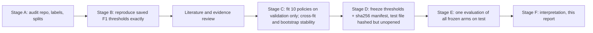

# CardioSentry — Clinical Threshold Study Results (ConvNeXt-Tiny V1 + RFPN, clean12)

**Status:** Research result for exploratory comparison, **not** an approved clinical protocol. No cardiologist has reviewed these thresholds.
**Model:** `prototype-results/new_runs/convnext_tiny_v1_rfpn_clean12_colab_a100_seed42/convnext_tiny_rfpn`
(`best.pt` sha256 `0ebd3b85…8483`, `inference.pt` sha256 `ab1b6bf5…d5a`). The model was not retrained and its weights were not touched.
**Implements:** `CardioSentry_Clinical_Threshold_Research_and_Implementation_Guide.md`, stages A–F.
**Code and outputs:** `threshold-configurations/v1-rfpn/threshold_research/`

---

## 0. Summary

**Thresholds frozen on validation before the test set was opened (primary policy `clinical_v1`).** Decision rule: `float32 sigmoid score >= threshold`.

| Label | Before (current max-F1) | **After (clinical_v1)** | Selection rule | Medical goal (short form) |
|---|---|---|---|---|
| NORM | 0.7892 | **0.9504** | max sensitivity s.t. Wilson-lower specificity ≥ 0.995 | Few false reassurances (abnormal ECG called normal) |
| SB | 0.6011 | **0.6011** | max-F1 (unchanged) | Balanced; low acuity, often physiological |
| STACH | 0.8007 | **0.8007** | max-F1 (unchanged) | Balanced; usually secondary to another cause |
| LBBB | 0.6352 | **0.6352** | max-F1 (unchanged) | Balanced; detecting it is not time-critical |
| LQT | 0.7326 | **0.7326** | max-F1 (unchanged) | Balanced; the label is a report statement that needs measuring anyway |
| AF | 0.7944 | **0.3157** | max-F2 | Leans toward catching AF; a physician confirms every call |
| AFL | 0.6114 | **0.2323** | max-F2 | Same anticoagulation pathway as AF |
| 3AVB | 0.8977 | **0.0888** | max specificity s.t. Wilson-lower sensitivity ≥ 0.90 | Sensitivity first: may need urgent pacing |
| 2AVB | 0.8918 | **0.4664** | max-F2 | Leans toward catching it; the label mixes subtypes and is noisy |
| 1AVB | 0.7649 | **0.7649** | max-F1 (unchanged) | Balanced; benign |
| STEMI | 0.6243 | **0.1613** | max specificity s.t. Wilson-lower sensitivity ≥ 0.90 | Sensitivity first: a miss delays reperfusion |
| STE | 0.7017 | **0.2082** | max-F2 | Leans toward catching it, less aggressively than STEMI |

**Untouched test set (11,323 ECGs, 9,602 patients), before → after:**

| Label | Sensitivity % | Specificity % | PPV % | Missed (FN) | False alerts (FP) |
|---|---|---|---|---|---|
| STEMI | 81.9 → **92.0** | 97.05 → 93.09 | 70.9 → 53.9 | 165 → **73** | 307 → 719 |
| 3AVB | 72.1 → **93.5** | 99.72 → 98.08 | 78.2 → 40.2 | 43 → **10** | 31 → 214 |
| 2AVB | 72.6 → **81.9** | 99.74 → 98.70 | 90.1 → 67.6 | 100 → 66 | 29 → 143 |
| AF | 90.5 → **96.6** | 98.72 → 96.62 | 91.5 → 81.4 | 143 → 51 | 126 → 332 |
| AFL | 94.9 → **96.7** | 98.40 → 97.23 | 90.1 → 84.3 | 77 → 49 | 157 → 272 |
| STE | 84.1 → **92.5** | 98.39 → 95.35 | 89.4 → 76.2 | 250 → 117 | 157 → 454 |
| NORM | 95.9 → 91.0 | 99.11 → **99.67** | 94.3 → **97.7** | 62 → 135 | 87 → **32** |
| SB, STACH, LBBB, LQT, 1AVB | unchanged | unchanged | unchanged | unchanged | unchanged |

- **Fewer misses overall:** total missed findings fell from 1,668 to 1,329.
- **More false alerts:** total false alerts rose from 1,513 to 2,785.
- **Macro averages:** sensitivity rose 86.6 → 91.0 (paired 95% CI +3.7 to +5.1 pp), and macro F1 fell 87.4 → 83.9 (−4.1 to −2.9 pp).
- **Fewer false reassurances:** abnormal ECGs called "Normal" fell from 87 to 32.
- **STEMI goal met on test:** sensitivity 92.0%, Wilson 95% CI 90.1–93.6, so even the lower bound clears 0.90.
- **3AVB goal not proven on test:** sensitivity 93.5% (CI 88.5–96.4). The point estimate clears 0.90 but the lower bound does not, so the 0.90 goal is **not statistically demonstrated**.

The policy is a trade-off, not a free improvement. It moves misses away from STEMI, complete heart block, AF/flutter and ST elevation, and it cuts false "Normal" calls. The cost is two to seven times more false alerts on the labels that were changed (§8, §9).

---

## 1. What was done



**Deviations from the guide, and why:**

- **Calibration not applied (§5.9).** Validation calibration is already good: ECE ≤ 0.027 for 11 labels and 0.042 for LQT (`outputs/calibration_validation.csv`). A per-label monotone calibration cannot change any threshold decision. It would only rename the threshold values.
- **No expected-cost or decision-curve optimisation (§5.7).** There are no clinician-elicited harm ratios, and the dataset's prevalences are set by selection, not observed. Instead, §9.6 shows how PPV and false-alert burden would change at hospital-archive prevalence.
- **Two-tier thresholds (§5.8): analysis only.** For STEMI and 3AVB, §9.4 reports a "review" band between the clinical threshold and the F1 threshold. It is not built into any output.
- **No edits to the training notebook or the app.** The thresholds live in versioned JSON files (§13). The app's active model is ConvNeXt-V1 *Base* + RFPN, not this Tiny run.
- **One refit before freezing, test still unopened.** A first freeze was made, and then the policy was revised after the evidence review came back. LBBB and LQT went back to F1, STE moved from F1 to F2, and the `spec_0_95` comparison arm was added. `outputs/` was deleted and everything was refitted on validation. No test metric had been computed at that point. The test file was only hashed.
- **What had been seen of test before freezing:** only the per-label positive counts in `split_audit.json`. The original training run had already written F1 and 0.5 test metrics (`report.md`, `result.json`). They were not read during this study. The model owner may have seen them, which is a limitation (§11).

---

## 2. Stage A: repository and data audit

| Question (guide §6 Stage A) | Finding | Evidence |
|---|---|---|
| Label order | `NORM, SB, STACH, LBBB, LQT, AF, AFL, 3AVB, 2AVB, 1AVB, STEMI, STE`; identical in `config_snapshot.json`, `inference.pt["label_order"]` and the CSV columns. Enforced by `common.validate_label_order`. | `make_notebook.py:842` |
| Output type | 12 independent sigmoid probabilities (range 3e-7 to 0.99999), already post-sigmoid, stored as float32. | prediction CSVs |
| Checkpoint selection | `best.pt` = best epoch (8 of 13) by validation pathology macro AP, with raw-vs-EMA weights chosen on validation. Evaluation loads `best.pt` (`make_notebook.py:3762-3774`). Thresholds are stored in `inference.pt["thresholds"]` and `validation_tuned_thresholds.json`, **not** in `best.pt`. | run.log, notebook |
| Label encoding | Strictly 0/1. No uncertain or missing codes: records with hedged or uncertain statements were excluded upstream (tiers 5–8). | `heedb_clean12_rules.py`, `rank_clean12.py` |
| Reference standard | HEEDB **physician over-read** of GE 12SL statements (`codes_physician`). The HEEDB authors warn that over-reads mostly confirm the machine statement and should not be treated as definitive expert annotation ([Koscova 2026](https://doi.org/10.1038/s41597-026-06861-9)). | `LABEL_RULES_DETAILED.md:15` |
| Split unit | Patient (`patient_key`), iterative stratification, seed 20261002. Validation: 11,301 records / 9,638 patients. Test: 11,323 / 9,602. No patient appears in more than one split; no site overlap. | `split_audit.json` |
| Cached predictions | They come from the same `best.pt`. All local files match the Drive manifest sha256. | `drive_sync_manifest.json` |
| NORM semantics | NORM never co-occurs with a pathology. Every record has at least one label, so **NORM negatives = abnormal ECGs carrying one of the 11 target findings**. | validation labels; `RULES:421,437` |
| STE vs STEMI | **Every STEMI record is also STE.** STE is a superset, not "ST elevation without STEMI". | `rank_clean12.py:50-52` |
| 2AVB | Mobitz I, Mobitz II, 2:1 and high-grade are merged into one class. | `RULES:354-382` |
| LQT | Report statements (prolonged QT; QTcB ≥ 480); no QTc measurement. **Not** congenital LQTS. | `RULES:53-66` |
| AF / AFL | Never co-occur; records with both were excluded. | `RULES:432` |
| Label quality | In the signal audit, the waveform clearly supported the label in **34% (2AVB)** and **52% (3AVB)** of tier-1 records, against 75–92% for other classes. | `LABEL_RULES_OVERVIEW.md:118` |
| Prevalence | Set by selection, not natural: about 13% for most labels, 1.4% for 3AVB, 3.2% for 2AVB, 8.1% for STEMI. HEEDB archive shares are 0.08% (3AVB), 0.3% (2AVB) and 1.5% (STEMI). | `HEEDB_conditions.md` |
| Per-label support | Validation positives: 153 (3AVB, 129 patients), 365 (2AVB), 912 (STEMI, 675 patients), 1,500–1,709 for the rest. | `split_audit.json` |
| Test independence | The test split was never used for checkpoint selection, threshold tuning or policy choice in this study. Its F1 and 0.5 metrics existed beforehand (§1). | — |

---

## 3. Stage B: baseline reproduction

`fit_thresholds.reproduce_baseline` runs as a hard gate before anything else (`outputs/baseline_reproduction.json`):

- **Thresholds:** a verbatim port of the notebook's `tune_thresholds_on_validation` and the independent re-implementation (`max_fbeta(beta=1)`) both reproduce all 12 saved thresholds bit-exactly.
- **Stored predictions:** replaying `score >= threshold` in **float32** gives **0 mismatches** against the stored `pred_validation_tuned_*` columns (and 0 for `pred_0_5_*`).
- **float64 artefact:** comparing in float64 on the CSV text gives 9 mismatches. All 9 are rows where the score *equals* the threshold: the CSV stores the shortest float32 repr, while the JSON stores the float32 value widened to float64. The study therefore compares in float32 everywhere.

---

## 4. Evidence review: corrections to the guide and what supports each goal

Full matrix with ~40 rows and verification status for every source: `threshold_research/evidence_matrix.md`.

**Corrections to the guide's starting sources:**

- **[Ribeiro 2020](https://doi.org/10.1038/s41467-020-15432-4)** did *not* select thresholds on validation. The F1-max point is read off the **test-set** PR curve (Fig. 2), and validation was used only for hyperparameters. Do not cite it as validation-selected.
- **[CODE-II 2026](https://doi.org/10.1038/s41746-026-02704-4)** exists (Abreu et al., npj Digit Med). It is the closest methodological template: per-class F1-max on validation, applied unchanged to test, with Youden as a sensitivity analysis. On test it saw 3 rare classes with P = R = 0 at their validation thresholds.
- **[Kim 2022](https://doi.org/10.3346/jkms.2022.37.e81):** the first author is *Dongsung* Kim, and the abstract (67.5%) and Results (73.8%) disagree on STEMI prevalence. Based on 80 patients.
- **[2025 ACC/AHA ACS guideline](https://doi.org/10.1016/j.jacc.2024.11.009):** no AI or computerized-ECG performance target anywhere in the full text.
- **AHA Mission: Lifeline ([PreAct, Kontos 2020](https://doi.org/10.1161/JAHA.119.011963)):** no numeric sensitivity target.

**Main finding: no guideline or society sets a numeric sensitivity or specificity floor for any of the 12 labels in an AI or computerized-ECG context.** The only explicit numbers are protocol choices made by individual studies or sponsors:

| Source | Number | Context |
|---|---|---|
| [ROMIAE 2025](https://doi.org/10.1093/eurheartj/ehaf004) | rule-out cut-off designed for 99% sensitivity | acute MI, prospective ED |
| [Al-Zaiti 2023](https://doi.org/10.1038/s41591-023-02396-3) | rule-out NPV > 0.99, rule-in TPR > 0.50 | angiographic occlusion MI |
| [FDA DEN180044](https://www.accessdata.fda.gov/cdrh_docs/reviews/DEN180044.pdf) | AF performance goals: sensitivity 90%, specificity 92% | single-lead watch |

**What computer ECG reading achieves for STEMI today:**

- [JRC/JCS 2022 meta-analysis](https://doi.org/10.1253/circrep.CR-22-0002): pooled sensitivity 85.4%, specificity 95.4%.
- [Garvey 2016](https://doi.org/10.1016/j.jelectrocard.2016.04.010): against a culprit artery, sensitivity 0.62–0.69 at specificity 0.89–0.95.
- [Schläpfer & Wellens 2017](https://doi.org/10.1016/j.jacc.2017.07.723): computer reads should not be the sole trigger for cath-lab activation.

**What the guidelines do support is a direction, not a magnitude:**

- **STEMI:** urgent; ECG to be read within 10 minutes (2025 ACS guideline).
- **Mobitz II, high-grade and complete AV block:** pacing "regardless of symptoms" ([2018 ACC/AHA/HRS](https://doi.org/10.1161/CIR.0000000000000628)).
- **AF:** physician review of the ECG is required to confirm (Class I, [ESC 2024](https://doi.org/10.1093/eurheartj/ehae176)).
- **Asymptomatic SB and 1AVB:** benign, Class III for further intervention.
- **QT prolongation vs congenital LQTS:** different definitions (Rautaharju 2009; [ESC 2022](https://doi.org/10.1093/eurheartj/ehac262)).

**Consequence:** every numeric goal in `clinical_v1` is labelled **our experimental hypothesis**. The 0.90 floor is the *least aggressive* of the guide's scenario levels (0.90/0.95/0.98). It was chosen because 0.95 and 0.98 cost far more false alerts on validation (§7), and because 3AVB has only 153 validation positives, too few to demonstrate a floor of 0.95 or higher (Wilson table in `evidence_matrix.md`).

---

## 5. Methods

**Selection methods** (`threshold_methods.py`):

- **Candidate thresholds:** every metric is piecewise constant in the threshold, so the candidates are exactly the distinct observed scores. Each label's counts are computed once by sorting.
- **Constrained rules:**
  - *Sensitivity-constrained:* maximise specificity subject to the floor. Ties go to higher sensitivity, then higher threshold.
  - *Specificity-constrained:* the mirror image.
- **`use_wilson_lower`:** the lower 95% Wilson bound, not the point estimate, must reach the floor (guide §9.4). This builds in a margin so the goal is more likely to hold on unseen data.
- **F-beta:** computed from integer counts. Ties go to the lowest threshold, the same as the notebook.
- **Youden's J:** computed in the exact integer form `tp·N − fp·P`.
- **Status:** a fit that is infeasible, has no positives, has no negatives, or has no score separation returns `threshold=None` with an explicit status. Every fit in this study returned `ok`.

**Arms** (`policies.py`), all predeclared before test:

| Arm | Definition | Role |
|---|---|---|
| `fixed_0_5` | 0.5 for every label | engineering reference |
| `max_f1` | per-label max-F1 | **baseline (current CardioSentry)** |
| `max_f2` | per-label max-F2 | comparison |
| `youden_j` | per-label max J | comparison |
| `sens_0_90`, `sens_0_95`, `sens_0_98` | max specificity s.t. point sensitivity ≥ floor, all labels | sensitivity analysis (hypothesis scenarios) |
| `spec_0_95` | max sensitivity s.t. specificity ≥ 0.95, all labels | comparison against conventional computer STEMI reading (pooled specificity 95.4%) |
| `clinical_v1` | per-label rules in §6 | **primary** |
| `clinical_v1_strict` | as `clinical_v1`, but a 0.95 Wilson-lower floor for STEMI and 3AVB | predeclared variant |

**Statistics:**

- **Sensitivity and specificity:** Wilson 95% CI.
- **PPV, NPV, F1 and paired differences against `max_f1`:** patient-clustered percentile bootstrap, 2,000 rounds, seed 20261015, patient key = `site:patient_key`.
- **Before test, on validation only:**
  - *Threshold stability:* refit on 300 patient-bootstrap resamples.
  - *Transport estimate:* 50 repeats of patient-level 2-fold cross-fitting (fit on one half, score the other).

**Freeze** (`outputs/frozen/freeze_manifest.json`): sha256 of every threshold file, both checkpoints, the validation CSV, the test CSV (pinned, not parsed), and the code; git HEAD `811541b`. `evaluate_test.py` refuses to run if any hash differs, if a primary or baseline label is not `ok`, or if a review threshold is above its alert threshold.

The fitting, evaluation, metric and policy code still matches the frozen hashes. Only `make_report_tables.py`, which formats tables, was edited after the freeze.

---

## 6. The thresholds and why: per-label rationale

Stated plainly, the clinical-safety logic is:

- **A miss can hurt:** for findings where a miss leads to delayed time-critical treatment and a false alert costs a clinician's look, push sensitivity up and accept more false alerts.
- **Low acuity or noisy label:** for findings where neither holds, keep the balanced F1 point.
- **"Normal":** the dangerous error is the false positive, so push specificity up.

"Bootstrap range" is the 95% range of the threshold refitted on validation patient resamples, i.e. how stable the cut-off is.

### NORM — Normal ECG → **0.9504** (was 0.7892)
- **Goal:** a "Normal" output reassures the reader. Its harmful error is calling an abnormal ECG normal, which in this dataset is a NORM false positive, since NORM negatives are exactly the abnormal ECGs. CODE-II supports a high-precision normal class qualitatively.
- **Rule:** maximise NORM sensitivity subject to the Wilson-lower specificity ≥ 0.995, i.e. at most about 5 false reassurances per 1,000 abnormal ECGs. *Experimental hypothesis.*
- **Validation:** false reassurances 79 → 34. NORM sensitivity 95.9 → 91.5%: 65 more normal ECGs are not labelled "Normal". Those receive no label, or a pathology label, instead of a reassuring one.
- **Test:** abnormal ECGs called NORM 87 → **32**. NORM PPV 94.3 → 97.7%. Bootstrap range 0.924–0.968.

### SB — Sinus bradycardia → **0.6011** (unchanged, max-F1)
- **Why unchanged:** often physiological. Asymptomatic SB is Class III for pacing (2018 ACC/AHA/HRS), and the label is a report statement with no rate check.
- **Performance:** already high (test 96.8% / 99.12%), so recall weighting has nothing to gain.

### STACH — Sinus tachycardia → **0.8007** (unchanged, max-F1)
- **Why unchanged:** usually secondary to another process; no guideline gives a detection target. Test 91.5% / 99.50%.

### LBBB → **0.6352** (unchanged, max-F1)
- **Why unchanged:** detecting LBBB is not itself time-critical; new LBBB alone is no longer treated as STEMI-equivalent (2025 ACS). Its clinical relevance is as a confounder of STEMI.
- **Performance:** test 98.1% / 99.02%.
- **STEMI within LBBB:** only **1** test STEMI record has LBBB, so this subgroup cannot be evaluated.

### LQT — QT/QTc prolongation → **0.7326** (unchanged, max-F1)
- **What the label is:** a report statement, not a QTc measurement and not congenital LQTS. It is the model's weakest common label (test AUROC 0.968, AP 0.870).
- **Why not lean toward sensitivity:** on test, F2 would raise sensitivity to 90.3% but nearly quadruple false positives (specificity 97.5 → 90.4%). For a finding a clinician must measure anyway, that alert burden is not justified.
- **Status:** a known weak point — **72.9% test sensitivity**. Threshold tuning cannot fix this; it needs better QT labels or measurement.

### AF — Atrial fibrillation → **0.3157** (was 0.7944, max-F2)
- **Goal:** a missed AF delays stroke-risk assessment. Every automated AF call must be confirmed by a physician reading the ECG (ESC 2024, Class I), so false alerts are reviewable. Hence mildly recall-weighted F2 rather than a hard floor; no published floor exists for 12-lead AF.
- **Test:** sensitivity 90.5 → **96.6%** (misses 143 → 51); specificity 98.72 → 96.62%.

### AFL — Atrial flutter → **0.2323** (was 0.6114, max-F2)
- **Goal:** same anticoagulation consequence as AF (ESC 2024). AF↔AFL confusion matters less than missing both.
- **Test:** sensitivity 94.9 → **96.7%**. Combined AF∪AFL sensitivity 96.6 → **98.9%**, specificity 98.5 → 96.9%.

### 3AVB — Complete AV block → **0.0888** (was 0.8977)
- **Goal:** can need urgent pacing (pacing "regardless of symptoms", 2018 ACC/AHA/HRS). A miss is high-consequence; a false alert costs a clinician's review.
- **Rule:** maximise specificity subject to the Wilson-lower validation sensitivity ≥ **0.90**. *Experimental hypothesis.* The Wilson margin was chosen because the point-estimate rule transported poorly in cross-fitting: its 5th-percentile out-of-fold sensitivity was 0.79, against 0.91 with the margin.
- **Validation:** 80.4 → 94.8% sensitivity.
- **Test:** **93.5% [88.5–96.4]**, misses 43 → 10, specificity 99.72 → 98.08%.
- **Caveats:**
  - PPV falls to 40%.
  - Bootstrap range 0.037–0.240 (unstable, few positives).
  - Only about half of 3AVB labels are clearly supported by the waveform.

### 2AVB — Second-degree AV block → **0.4664** (was 0.8918, max-F2)
- **Goal:** Mobitz II and high-grade block need pacing, but the label merges them with benign Mobitz I and 2:1, and it is the noisiest label (34% waveform support).
- **Why not a hard floor:** on test, the 0.90 floor would cost 665 false positives (specificity 93.9%), largely spent chasing weakly supported labels. Recall-weighted F2 is the compromise.
- **Test:** sensitivity 72.6 → **81.9%**, specificity 99.74 → 98.70%.
- **Status:** still misses 18%. A Mobitz II / high-grade sub-analysis needs subtype metadata that was not exported with the predictions.

### 1AVB → **0.7649** (unchanged, max-F1)
- **Why unchanged:** benign (PR > 200 ms); asymptomatic 1AVB needs no further work-up (Class III). Test 88.0% / 98.51%.

### STEMI — STEMI pattern → **0.1613** (was 0.6243)
- **Goal:** missing an ST-elevation MI pattern delays reperfusion. False alerts are triaged by a clinician, as computer ECG reads already are (Schläpfer & Wellens).
- **Rule:** maximise specificity subject to the Wilson-lower validation sensitivity ≥ **0.90**. *Experimental hypothesis.*
- **Validation:** 80.4 → 92.1% sensitivity, 96.86 → 92.77% specificity.
- **Test:** **92.0% [90.1–93.6]**, misses 165 → **73**, false alerts 307 → 719, PPV 70.9 → 53.9%. Bootstrap range 0.087–0.249.
- **Against conventional computer reading:** at matched specificity ≥ 0.95, the model reaches 87.5% test sensitivity (`spec_0_95` arm), similar to the pooled 85.4% for computer-assisted reading. The comparison crosses study designs and populations, so it is indicative only.

### STE — ST elevation → **0.2082** (was 0.7017, max-F2)
- **Goal:** STE is a superset of STEMI with many benign look-alikes (early repolarisation, pericarditis, LVH, LBBB). It leans toward sensitivity, but less aggressively than STEMI: recall-weighted F2, no hard floor.
- **Test:** sensitivity 84.1 → **92.5%**, specificity 98.39 → 95.35%.

---

## 7. Validation results (threshold-selection data)

These are optimistic by construction, because the thresholds were selected on this data; the same validation set also selected the checkpoint.

| Label | n_pos | Sensitivity % | Specificity % | PPV % | F1 % | FN | FP |
|---|---|---|---|---|---|---|---|
| NORM | 1500 | 95.9 → 91.5 | 99.19 → 99.65 | 94.8 → 97.6 | 95.3 → 94.5 | 62 → 127 | 79 → 34 |
| SB | 1500 | 97.3 → 97.3 | 99.29 → 99.29 | 95.4 → 95.4 | 96.4 → 96.4 | 40 → 40 | 70 → 70 |
| STACH | 1501 | 91.1 → 91.1 | 99.42 → 99.42 | 96.0 → 96.0 | 93.5 → 93.5 | 133 → 133 | 57 → 57 |
| LBBB | 1709 | 97.7 → 97.7 | 99.15 → 99.15 | 95.3 → 95.3 | 96.5 → 96.5 | 39 → 39 | 82 → 82 |
| LQT | 1616 | 75.6 → 75.6 | 97.36 → 97.36 | 82.7 → 82.7 | 79.0 → 79.0 | 394 → 394 | 256 → 256 |
| AF | 1500 | 92.1 → 96.8 | 98.92 → 97.15 | 92.9 → 83.9 | 92.5 → 89.9 | 118 → 48 | 106 → 279 |
| AFL | 1507 | 95.7 → 97.5 | 98.87 → 98.03 | 92.9 → 88.4 | 94.2 → 92.7 | 65 → 37 | 111 → 193 |
| 3AVB | 153 | 80.4 → 94.8 | 99.88 → 98.08 | 90.4 → 40.4 | 85.1 → 56.6 | 30 → 8 | 13 → 214 |
| 2AVB | 365 | 72.6 → 81.6 | 99.78 → 98.77 | 91.7 → 69.0 | 81.0 → 74.8 | 100 → 67 | 24 → 134 |
| 1AVB | 1529 | 89.6 → 89.6 | 98.74 → 98.74 | 91.8 → 91.8 | 90.7 → 90.7 | 159 → 159 | 123 → 123 |
| STEMI | 912 | 80.4 → 92.1 | 96.86 → 92.77 | 69.2 → 52.8 | 74.4 → 67.1 | 179 → 72 | 326 → 751 |
| STE | 1569 | 85.0 → 93.4 | 98.42 → 95.35 | 89.6 → 76.4 | 87.2 → 84.1 | 236 → 103 | 154 → 453 |

**Why the stricter floors were not chosen as primary (validation STEMI / 3AVB):**

| Rule | STEMI sens / spec / FP | 3AVB sens / spec / FP |
|---|---|---|
| max-F1 (baseline) | 80.4 / 96.9 / 326 | 80.4 / 99.9 / 13 |
| Wilson-lower ≥ 0.90 (**clinical_v1**) | 92.1 / 92.8 / 751 | 94.8 / 98.1 / 214 |
| Wilson-lower ≥ 0.95 (strict) | 96.5 / 86.6 / 1,387 | 98.7 / 96.3 / 413 |
| point ≥ 0.98 | 98.0 / 78.1 / 2,271 | 98.0 / 96.9 / 351 |

On the strict arm, 3AVB's Wilson-lower 0.95 fit was infeasible in 27 of 100 half-sample cross-fits. The 0.95 level cannot be supported reliably with about 150 positives.

**Expected degradation on unseen patients (cross-fit, validation only).** These estimates were made before test and matched test closely:

| Label | Val sens | Cross-fit OOF sens (5th pct) | **Test sens** | Val spec | OOF spec | **Test spec** |
|---|---|---|---|---|---|---|
| NORM | 91.5 | 90.2 (87.3) | 91.0 | 99.65 | 99.70 | 99.67 |
| AF | 96.8 | 96.2 (94.6) | 96.6 | 97.15 | 97.25 | 96.62 |
| AFL | 97.5 | 97.2 (95.7) | 96.7 | 98.03 | 98.00 | 97.23 |
| 3AVB | 94.8 | 96.4 (91.1) | 93.5 | 98.08 | 97.15 | 98.08 |
| 2AVB | 81.6 | 79.9 (74.7) | 81.9 | 98.77 | 98.81 | 98.70 |
| STEMI | 92.1 | 92.7 (89.0) | 92.0 | 92.77 | 91.92 | 93.09 |
| STE | 93.4 | 92.8 (90.4) | 92.5 | 95.35 | 95.53 | 95.35 |

The validation curves with the F1, F2, Youden and clinical points marked are in `threshold_research/outputs/figures/validation_operating_points.png`.

---

## 8. Test results: before (max-F1) vs after (clinical_v1)

Each label's frozen threshold was applied once. The sensitivity CI is Wilson; the PPV CI is the patient-clustered bootstrap.

| Label | n_pos | Sens before [95% CI] | Sens after [95% CI] | Spec % | PPV % (after CI) | NPV % | F1 % | FN | FP |
|---|---|---|---|---|---|---|---|---|---|
| NORM | 1500 | 95.9 [94.7–96.8] | **91.0** [89.4–92.3] | 99.11 → **99.67** | 94.3 → **97.7** [96.8–98.6] | 99.37 → 98.64 | 95.1 → 94.2 | 62 → 135 | 87 → 32 |
| SB | 1500 | 96.8 [95.8–97.6] | 96.8 [95.8–97.6] | 99.12 → 99.12 | 94.4 → 94.4 | 99.51 → 99.51 | 95.6 → 95.6 | 48 → 48 | 86 → 86 |
| STACH | 1501 | 91.5 [90.0–92.8] | 91.5 [90.0–92.8] | 99.50 → 99.50 | 96.6 → 96.6 | 98.72 → 98.72 | 94.0 → 94.0 | 127 → 127 | 49 → 49 |
| LBBB | 1707 | 98.1 [97.4–98.7] | 98.1 [97.4–98.7] | 99.02 → 99.02 | 94.7 → 94.7 | 99.67 → 99.67 | 96.4 → 96.4 | 32 → 32 | 94 → 94 |
| LQT | 1615 | 72.9 [70.7–75.1] | 72.9 [70.7–75.1] | 97.49 → 97.49 | 82.8 → 82.8 | 95.59 → 95.59 | 77.6 → 77.6 | 437 → 437 | 244 → 244 |
| AF | 1500 | 90.5 [88.9–91.9] | **96.6** [95.6–97.4] | 98.72 → **96.62** | 91.5 → **81.4** [79.5–83.2] | 98.55 → 99.47 | 91.0 → 88.3 | 143 → 51 | 126 → 332 |
| AFL | 1506 | 94.9 [93.7–95.9] | **96.7** [95.7–97.5] | 98.40 → **97.23** | 90.1 → **84.3** [82.5–86.0] | 99.21 → 99.49 | 92.4 → 90.1 | 77 → 49 | 157 → 272 |
| 3AVB | 154 | 72.1 [64.5–78.6] | **93.5** [88.5–96.4] | 99.72 → **98.08** | 78.2 → **40.2** [34.0–46.2] | 99.62 → 99.91 | 75.0 → 56.2 | 43 → 10 | 31 → 214 |
| 2AVB | 365 | 72.6 [67.8–76.9] | **81.9** [77.6–85.5] | 99.74 → **98.70** | 90.1 → **67.6** [62.0–72.7] | 99.09 → 99.39 | 80.4 → 74.1 | 100 → 66 | 29 → 143 |
| 1AVB | 1529 | 88.0 [86.2–89.5] | 88.0 [86.2–89.5] | 98.51 → 98.51 | 90.2 → 90.2 | 98.13 → 98.13 | 89.1 → 89.1 | 184 → 184 | 146 → 146 |
| STEMI | 912 | 81.9 [79.3–84.3] | **92.0** [90.1–93.6] | 97.05 → **93.09** | 70.9 → **53.9** [50.8–56.7] | 98.39 → 99.25 | 76.0 → 67.9 | 165 → 73 | 307 → 719 |
| STE | 1568 | 84.1 [82.2–85.8] | **92.5** [91.1–93.7] | 98.39 → **95.35** | 89.4 → **76.2** [74.0–78.2] | 97.46 → 98.76 | 86.6 → 83.6 | 250 → 117 | 157 → 454 |

**Paired difference, clinical_v1 − max-F1** (percentage points, patient-clustered bootstrap 95% CI):

| Label | ΔSensitivity | ΔSpecificity | ΔPPV | ΔF1 |
|---|---|---|---|---|
| NORM | −4.9 [−6.0, −3.9] | +0.6 [+0.4, +0.7] | +3.4 [+2.6, +4.3] | −0.8 [−1.6, −0.1] |
| AF | +6.1 [+4.9, +7.4] | −2.1 [−2.4, −1.8] | −10.1 [−11.6, −8.7] | −2.7 [−3.8, −1.6] |
| AFL | +1.9 [+1.2, +2.5] | −1.2 [−1.4, −1.0] | −5.8 [−7.0, −4.8] | −2.4 [−3.1, −1.7] |
| 3AVB | +21.5 [+15.5, +28.3] | −1.6 [−1.9, −1.4] | −37.9 [−44.2, −32.0] | −18.7 [−24.8, −12.8] |
| 2AVB | +9.3 [+6.3, +12.8] | −1.0 [−1.2, −0.8] | −22.5 [−27.1, −18.3] | −6.3 [−9.5, −3.3] |
| STEMI | +10.1 [+8.1, +12.2] | −4.0 [−4.3, −3.6] | −17.0 [−18.9, −15.2] | −8.0 [−9.8, −6.3] |
| STE | +8.5 [+7.0, +10.0] | −3.0 [−3.4, −2.7] | −13.2 [−14.8, −11.7] | −3.1 [−4.3, −1.9] |
| SB, STACH, LBBB, LQT, 1AVB | 0 | 0 | 0 | 0 |

### Goal attainment (predeclared, reported whether met or not)

| Goal | Test result | Verdict |
|---|---|---|
| STEMI sensitivity ≥ 0.90 | 839/912 = 92.0% [90.1–93.6] | **Met**: the lower bound clears 0.90 |
| 3AVB sensitivity ≥ 0.90 | 144/154 = 93.5% [88.5–96.4] | **Point estimate met; not statistically demonstrated** (lower bound 88.5%) |
| NORM specificity ≥ 0.995 | 9,791/9,823 = 99.67% | **Met** (32 abnormal ECGs called NORM) |
| `clinical_v1_strict`: STEMI ≥ 0.95 | 885/912 = 97.0% [95.7–98.0] at specificity 87.2% (1,329 FP) | Met, at a large false-alert cost |
| `clinical_v1_strict`: 3AVB ≥ 0.95 | 148/154 = 96.1% [91.8–98.2] at specificity 96.2% | Point estimate met; lower bound not |

---

## 9. Multi-label, safety and alert-burden results (test)

### 9.1 Aggregates for every frozen arm

| Policy | Macro sens % | Macro spec % | Macro PPV % | Macro F1 % | Total FN | Total FP | Records with ≥ 1 false alert /1000 |
|---|---|---|---|---|---|---|---|
| fixed_0_5 | 91.1 | 97.9 | 81.8 | 86.1 | 1117 | 2565 | 182.3 |
| **max_f1 (before)** | 86.6 | 98.7 | 88.6 | 87.4 | 1668 | 1513 | 114.3 |
| max_f2 | 92.6 | 96.7 | 78.0 | 84.4 | 777 | 3932 | 266.5 |
| youden_j | 95.8 | 95.4 | 69.2 | 78.3 | 607 | 5545 | 332.8 |
| sens_0_90 | 90.2 | 97.5 | 79.6 | 82.7 | 1530 | 3044 | 219.7 |
| sens_0_95 | 95.0 | 94.9 | 71.0 | 78.1 | 769 | 6253 | 384.6 |
| sens_0_98 | 97.7 | 90.2 | 60.6 | 70.9 | 328 | 11933 | 571.9 |
| spec_0_95 | 95.0 | 95.2 | 67.4 | 77.4 | 708 | 5714 | 315.0 |
| **clinical_v1 (after)** | 91.0 | 97.7 | 80.0 | 83.9 | 1329 | 2785 | 196.0 |
| clinical_v1_strict | 91.6 | 97.1 | 77.7 | 81.7 | 1279 | 3601 | 243.6 |

**Fixed 0.5 compared with clinical_v1.** The plain 0.5 cut-off has similar *aggregate* numbers to `clinical_v1`: 1,117 FN and 2,565 FP. The two differ in *where* the errors fall:

| | fixed 0.5 | clinical_v1 |
|---|---|---|
| STEMI sensitivity | 85.0% | 92.0% |
| 3AVB sensitivity | 83.8% | 93.5% |
| Abnormal ECGs called NORM | 161 | 32 |
| LQT / 1AVB sensitivity | higher | lower |

`clinical_v1` spends its false alerts on the high-consequence findings and on NORM safety, which is the point of a clinical policy. Macro averages hide this.

### 9.2 Normal-label safety (guide §9.7)

| Quantity (test) | fixed 0.5 | max-F1 | clinical_v1 |
|---|---|---|---|
| Abnormal ECGs predicted NORM | 161 | 87 | **32** |
| Abnormal ECGs *displayed* as Normal (NORM positive and no pathology alert) | 53 | 69 | **25** |
| Abnormal ECGs with no pathology alert at all | 61 | 141 | **59** |
| Any-abnormal sensitivity (≥ 1 pathology alert) | 99.4% | 98.6% | **99.4%** |
| Normal ECGs with ≥ 1 pathology false alert | 97 | 61 | 111 |

- **Presentation rule:** the "display as Normal" row adds a rule on top of the model output: show Normal only when no pathology alert fires. The app already applies this to its triage colour (green only when NORM is positive and nothing else is; `services/guidance.py`). The rule changes what is displayed, not the benchmark predictions, which are reported unaltered.
- **Scope limit:** NORM specificity here is measured only against ECGs with one of the 11 target findings. Abnormal ECGs outside the 12 classes (RBBB, LVH, old infarct …) are absent from clean12, so false reassurance on them is **unmeasured**.

### 9.3 Source-site consistency (test sensitivity / specificity %, clinical_v1)

| Label | I0001 | I0006 |
|---|---|---|
| STEMI | 90.4 / 93.5 (n=606) | 95.1 / 92.3 (n=306) |
| 3AVB | 91.1 / 98.1 (n=112) | 100.0 / 98.1 (n=42) |
| 2AVB | 82.9 / 98.7 (n=217) | 80.4 / 98.7 (n=148) |
| AF | 96.3 / 96.2 (n=1127) | 97.6 / 97.4 (n=373) |
| NORM | 90.2 / 99.6 (n=900) | 92.2 / 99.7 (n=600) |

The direction holds at both sites. I0001's STEMI sensitivity (90.4%) sits right at the goal. Full table: `outputs/report_tables.md` T10.

### 9.4 Two-tier view, analysis only (guide §5.8)

| Label | Review tier (clinical ≤ score < F1) | Review tier /1000 ECGs | True positives in review tier | Review-tier PPV | Missed below review |
|---|---|---|---|---|---|
| STEMI | 0.1613 ≤ s < 0.6243 | 44.5 | 92 of 504 | 18.3% | 73 |
| 3AVB | 0.0888 ≤ s < 0.8977 | 19.1 | 33 of 216 | 15.3% | 10 |

A product could show the review tier as "possible STEMI pattern — review" and keep a separate high-confidence alert at the F1 threshold. That would preserve the F1 alert's PPV (70.9%) while still surfacing the 92 extra STEMI positives. This design was not evaluated as a product rule.

### 9.5 Every frozen arm, per label (test sensitivity / specificity %)

| Label | max_f1 | max_f2 | youden_j | sens_0_90 | sens_0_95 | spec_0_95 | clinical_v1 | clinical_v1_strict |
|---|---|---|---|---|---|---|---|---|
| NORM | 95.9 / 99.1 | 97.7 / 98.5 | 98.4 / 97.9 | 89.2 / 99.8 | 95.0 / 99.3 | 99.7 / 95.4 | 91.0 / 99.7 | 91.0 / 99.7 |
| LQT | 72.9 / 97.5 | 90.3 / 90.4 | 91.0 / 89.0 | 89.8 / 90.9 | 94.3 / 84.5 | 81.6 / 95.4 | 72.9 / 97.5 | 72.9 / 97.5 |
| AF | 90.5 / 98.7 | 96.6 / 96.6 | 97.7 / 95.4 | 87.9 / 99.1 | 94.8 / 97.8 | 98.4 / 94.7 | 96.6 / 96.6 | 96.6 / 96.6 |
| 3AVB | 72.1 / 99.7 | 76.6 / 99.6 | 96.1 / 96.2 | 90.3 / 98.8 | 93.5 / 97.9 | 96.1 / 96.2 | 93.5 / 98.1 | 96.1 / 96.2 |
| 2AVB | 72.6 / 99.7 | 81.9 / 98.7 | 92.3 / 93.1 | 92.1 / 93.9 | 95.9 / 85.8 | 91.2 / 95.0 | 81.9 / 98.7 | 81.9 / 98.7 |
| STEMI | 81.9 / 97.1 | 90.4 / 93.8 | 93.8 / 91.9 | 90.0 / 94.2 | 96.1 / 88.9 | 87.5 / 95.3 | 92.0 / 93.1 | 97.0 / 87.2 |
| STE | 84.1 / 98.4 | 92.5 / 95.3 | 92.5 / 95.3 | 90.2 / 97.0 | 95.0 / 92.5 | 92.6 / 95.3 | 92.5 / 95.3 | 92.5 / 95.3 |

All 12 labels × 10 arms, for validation and test: `outputs/report_tables.md` T7. Point-estimate floors (`sens_0_90`/`0_95`) landed within about 1–2 pp of their target on test, sometimes below (AF 87.9% for the 0.90 floor), which is why the primary policy uses the Wilson margin.

### 9.6 Alert burden at hospital-archive prevalence (illustrative, not observed)

Test sensitivity and specificity re-weighted to the share of ECGs carrying each statement in the HEEDB I0001 archive (12SL v24). Assumes the archive's negatives look like clean12 negatives, which they do not entirely.

| Label | Test prevalence | Archive prevalence | PPV at archive prevalence, before → after | False alerts per 1,000 ECGs, before → after |
|---|---|---|---|---|
| STEMI | 8.1% | 1.5% | 29.7% → 16.9% | 29.0 → 68.0 |
| 3AVB | 1.4% | 0.08% | 17.2% → 3.8% | 2.8 → 19.1 |
| 2AVB | 3.2% | 0.3% | 45.2% → 15.9% | 2.6 → 13.0 |
| STE | 13.8% | 0.9% | 32.2% → 15.3% | 15.9 → 46.1 |
| AF | 13.2% | 7.3% | 84.7% → 69.2% | 11.9 → 31.3 |
| NORM | 13.2% | 15.5% | 95.2% → 98.1% | 7.5 → 2.8 |

At realistic prevalence, a 3AVB alert under `clinical_v1` would be right about 1 time in 26, and a STEMI alert about 1 in 6. This is acceptable only for a **screening prompt that a clinician confirms**. It is not acceptable for any autonomous action. The class-balanced PPVs in §8 overstate real-world PPV.

---

## 10. Conclusions (Stage F)

1. **Threshold choice alone moved clinically important misses a lot.** Without retraining:
   - STEMI misses fell 56% (165 → 73) and complete-heart-block misses 77% (43 → 10).
   - AF∪AFL sensitivity rose to 98.9%.
   - False "Normal" calls on abnormal ECGs fell 63% (87 → 32).

   All of these gains held on the untouched test set, within the cross-fit predictions made on validation.
2. **The cost is real and roughly predictable.** About 1,270 more false alerts per 11,323 test ECGs, PPV falling 10–38 pp on the changed labels, and much lower PPV at real-world prevalence (§9.6). Macro F1 falls 3.5 pp. Judged on F1 alone, the clinical policy "loses", which is expected and is not the criterion.
3. **The 0.90 STEMI goal transported; the 3AVB goal is not demonstrable** with 154 test positives. Floors of 0.95 or higher for STEMI cost specificity of 87% or below. No published target justifies paying that.
4. **Threshold tuning cannot fix three labels:**
   - **LQT:** sensitivity 73% at a reasonable specificity.
   - **2AVB:** 82%.
   - **STEMI:** best achievable specificity around 93% at 92% sensitivity.

   The limits there are label quality (2AVB and 3AVB waveform support of 34% and 52%; LQT has no measurement) and model discrimination, not thresholds.
5. **Recommendation:**
   - Use `clinical_v1` for research demos only, labelled exploratory, with the review-tier presentation for STEMI and 3AVB.
   - Keep `max_f1` as the documented benchmark.
   - Get cardiologist sign-off on the 0.90 and 0.995 hypotheses before any clinical-facing use.

---

## 11. Limitations

- **Reference standard:** physician-confirmed GE 12SL report statements, not angiography or adjudicated diagnosis. "Sensitivity" means agreement with the report.
- **2AVB and 3AVB label noise:** 34% and 52% waveform support. High "sensitivity" on these partly means reproducing noisy labels.
- **Prevalence by selection:** PPV, NPV, F1 and F2 do not carry over to deployment. Specificity is measured only against the other 11 target findings.
- **Validation used twice:** the same validation set chose both the checkpoint and the thresholds. Cross-fit transport matched test well, so the optimism looks small.
- **Test results already existed:** F1 and 0.5 test metrics were written by the original run before this study. This study did not read them, but test independence for *future* model decisions is no longer pristine. An external dataset is needed for unbiased claims.
- **Wilson bounds treat records as independent:** 3AVB has 153 records from 129 patients, so the safety margin is slightly optimistic. Test CIs for PPV, NPV and F1 and the paired differences are patient-clustered.
- **Only 1 STEMI-in-LBBB record**, so the Sgarbossa-relevant subgroup cannot be evaluated. No 2AVB subtype analysis: subtype is not in the prediction CSVs.
- **Image modality:** clean renders only. Photographed or scanned ECGs are not evaluated. The app's CPU-fp32 scores differ from the training run's BF16 scores by up to 8.8e-3 (`models/convnext_v1_base_rfpn_clean12.yaml` parity note), so operating points in the app are approximate.
- **No clinical adviser review.**

---

## 12. Decision questions (guide §12)

| # | Question | Answer |
|---|---|---|
| 1 | Intended use | Treated as a clinician-facing **screening aid / thesis benchmark**. Thresholds assume every positive is reviewed by a clinician. |
| 2 | Ground truth | Physician over-read of GE 12SL statements; no QTc or heart-rate measurements; 2AVB and 3AVB weakly supported by waveform. |
| 3 | Enough positives for 90–98% floors? | STEMI: yes for 0.90 (912 validation positives). 3AVB: 0.90 feasible but not demonstrable on test (154 positives); 0.95+ not supportable. |
| 4 | Test untouched? | Untouched by this study's selection; the original run's test metrics existed beforehand. Patients are partitioned with no cross-split overlap. |
| 5 | Evidence vs hypothesis | Directions come from guidelines; every number is our hypothesis (§4). |
| 6 | Can users absorb the extra alerts? | Unknown; needs workflow input. Burden is quantified in §9.1 and §9.6. |
| 7 | Calibration | Already good (ECE ≤ 0.042); not needed for threshold transport, so not applied. |
| 8 | Normal-class safety | 32 false "Normal" calls per 9,823 abnormal test ECGs; 25 with the display rule. Abnormalities outside the 12 classes are unmeasured. |
| 9 | Threshold stability | Bootstrap ranges are in §6. They are wide for 3AVB (0.037–0.240), 2AVB and LBBB, and tight for NORM (0.924–0.968) and STEMI (0.087–0.249). |
| 10 | Deployment scope | Research or educational only. App integration was described but not performed (§13). |

---

## 13. Using the thresholds

**Frozen artifact:** `threshold_research/outputs/frozen/thresholds_clinical_v1.json`. It records the label order, float32 `>=` semantics, method and parameters per label, status, rationale, and checkpoint hashes.

The CardioSentry app currently serves `convnext_v1_base_rfpn_clean12` (V1 *Base*). **These thresholds belong to the V1 *Tiny* RFPN run and must not be applied to the Base model.** If this Tiny model gets its own descriptor, the existing explicit-threshold hook takes them by position in `labels` order (`backend/services/runner.py:159-176`):

```yaml
# clinical_v1@research_v1 — exploratory, NOT clinically approved
thresholds:
  source: explicit
  explicit: [0.9504110217094421, 0.6011253595352173, 0.8006919622421265, 0.6352224349975586,
             0.7325918078422546, 0.31573596596717834, 0.23231014609336853, 0.08882029354572296,
             0.4663594961166382, 0.7648916244506836, 0.16132023930549622, 0.20817892253398895]
```

For one-off comparisons, the per-request override (`POST /api/captures/{id}/predict` with `{"thresholds": {...}}`) records the run as `user_override`.

---

## 14. Quality gates (guide §10)

| # | Gate | Status |
|---|---|---|
| 1 | Model untouched | `best.pt` / `inference.pt` sha256 recorded at freeze and re-verified before test; no training code runs |
| 2 | Baseline reproduced | Bit-exact, 0 prediction mismatches in float32 (§3) |
| 3 | Multi-label shape | `predict` returns (N, 12); unit test confirms co-positive labels are allowed |
| 4 | `>=` semantics | Unit test: a score equal to the threshold is positive, `nextafter` above is negative |
| 5 | PR indexing | Hand-computed F1 test against the sklearn notebook port |
| 6 | Sensitivity-constrained correctness | Brute-force enumeration with heavy ties, 25 seeds × 4 floors |
| 7 | Joint infeasibility | Unit test: `infeasible_constraint`, `threshold=None` |
| 8 | No positives / negatives | Explicit statuses for all methods |
| 9 | All-tied scores | `no_score_separation`, deterministic |
| 10 | Missing labels | N/A: none in the data (verified 0/1 only); loader rejects other values |
| 11 | Label order | Permuted order raises `LabelOrderError` |
| 12 | Test immutability | `require_development_split` rejects test in fitting; test hashed but not parsed at freeze; `evaluate_test.py` verifies the manifest |
| 13 | Reproducibility | Re-running `evaluate_test.py` gives byte-identical result CSVs (checked) |
| 14 | Calibration isolation | N/A (not applied) |
| 15 | Normal safety | §9.2 reports both raw predictions and the display rule |
| 16 | Patient leakage | No patient appears in more than one split; bootstrap clusters by patient |
| 17 | Privacy | Outputs hold aggregate metrics only; no record IDs or patient keys |
| 18 | Claim discipline | §0, §8 goal table and §11 |

Unit tests: `cd threshold-configurations/v1-rfpn/threshold_research && ../../../.venv/bin/python -m pytest -q tests` → 69 passed. An independent code review before the freeze found no blocking issues; its four minor findings (Youden float tie, docstring, fallback-status guard, band-order guard) were fixed before freezing.

---

## 15. Reproduce

```bash
cd threshold-configurations/v1-rfpn/threshold_research
../../../.venv/bin/python -m pytest -q tests
../../../.venv/bin/python fit_thresholds.py      # validation only; refuses if outputs/frozen exists
../../../.venv/bin/python evaluate_test.py       # verifies freeze manifest, evaluates test once
../../../.venv/bin/python make_report_tables.py  # outputs/report_tables.md (all tables T1-T11)
```

| File | Content |
|---|---|
| `common.py` | label order, float32 loading, split guard, `predict` |
| `threshold_methods.py` | pure optimisers and statuses |
| `metrics.py` | per-label, multi-label and safety metrics; patient bootstrap |
| `policies.py` | every arm, with per-label rationale and evidence category |
| `fit_thresholds.py` | Stages B–D (validation, stability, cross-fit, calibration, freeze) |
| `evaluate_test.py` | Stage E |
| `evidence_matrix.md` | literature review with verification status |
| `outputs/frozen/` | threshold JSON per arm + `freeze_manifest.json` |
| `outputs/results_*.csv` | all validation and test metrics |
| `outputs/figures/` | validation operating curves; test sensitivity/specificity with CIs |
